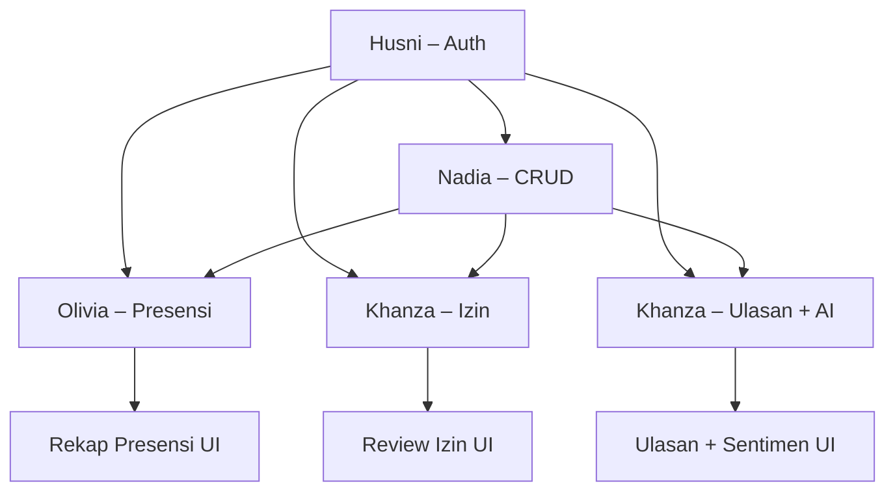

# Sprint 2 – TandaIU  
**Periode:** 13 Nov 2026 – 17 Nov 2026 (berakhir 23:59 WIB)  

Dokumen ini berisi **pembagian tugas**, **SRS**, **kontrak data & helper**, **struktur folder‑isolasi**, serta **check‑list merge** yang Anda (PM) hanya perlu *merge* PR‑PR. Semua hal di‑setup supaya tiap programmer dapat bekerja **independen** tanpa menunggu orang lain dan tanpa menimbulkan **merge conflict**.

---  

## 1. Ringkasan Tim & Branches  

| Programmer | Fokus utama | Branch Git |
|------------|--------------|-----------|
| **Husni Ulyaa Khanifah** | Auth & Role Management (login/registrasi/guard) | `feature/sprint-2-auth-role` |
| **Olivia Oktaviani** | Presensi realtime (buka/tutup sesi, check‑in, rekap) | `feature/sprint-2-presensi-realtime` |
| **Nadia Azura Nurhaniya** | CRUD kelas, jadwal, sesi + Security Rules | `feature/sprint-2-crud-praktikum` |
| **Khanza Qaila** | Pengajuan izin + ulasan pasca‑praktikum & AI‑sentimen (klasifikasi, review) | `feature/sprint-2-izin-ai` |

> **Catatan PM:** Anda hanya men‑merge PR‑PR di urutan yang tercantum pada bagian **6. Merge Process**.

---  

## 2. Deadline & Goal  

| Item | Target |
|------|--------|
| **Selesai semua fitur** | Selasa 17 Nov 2026 23:59 WIB |
| **CI** | `npm test`, `npx expo lint`, `npx expo doctor` all **green** |
| **Release tag** | `sprint-2-complete` (setelah semua merge) |

---  

## 3. Data Dummy – Single Source of Truth  

> Semua programmer **harus** mengambil data dari file‑file di bawah ini; **jangan** men‑hardcode nilai lain.  

| File (path) | Isi (ringkas) |
|-------------|---------------|
| `src/data/assistantIdentity.ts` | ```ts export const assistantIdentity = { name: 'Lily Collins', studentCode: '24060124123450', role: 'assistant', } as const; ``` |
| `src/data/praktikans.ts` | ```ts export const praktikans: Praktikan[] = [ { id:'p1', name:'Andi Pratama', studentCode:'24060124120001', semester:3 }, { id:'p2', name:'Budi Santoso', studentCode:'24060124120002', semester:1 }, /* … */ ]; ``` |
| `src/data/dosen.ts` | ```ts export const dosen = [ { id:'dos-01', name:'Nurul Hidayati, S.Kom., M.Kom.', nip:'199002142015122006' }, { id:'dos-02', name:'Dimas Setiawan, S.Kom., M.Cs.', nip:'199105112016121009' }, ] as const; ``` |
| `src/data/courses.ts` | (sama dengan sprint 1 – tidak diubah) |
| `src/data/sessions.ts` | ```ts export const initialSessions: PracticumSession[] = [ { id:'s5', courseId:'struktur-data', practicumName:'Struktur Data', className:'C1', lecturer:'Nurul Hidayati, S.Kom., M.Kom.', startsAt:'2026-10-27T08:00:00+07:00', endsAt:'2026-10-27T10:00:00+07:00', status:'dibuka' }, { id:'s6', courseId:'manajemen-basis-data', practicumName:'Manajemen Basis Data', className:'B2', lecturer:'Dimas Setiawan, S.Kom., M.Cs.', startsAt:'2026-10-27T13:00:00+07:00', endsAt:'2026-10-27T15:10:00+07:00', status:'terjadwal' }, ]; ``` |
| `src/data/attendances.ts` | `export const initialAttendances: Attendance[] = []; // akan di‑isi oleh presensi` |
| `src/data/permits.ts` | ```ts export const dummyPermits = [ { id:'perm-01', sessionId:'s5', studentId:'p1', studentName:'Andi Pratama', reason:'Demam tinggi, harus istirahat.', status:'pending', createdAt:'2026-10-27T06:30:00+07:00', }, ]; ``` |
| `src/data/reviews.ts` | ```ts export const dummyReviews = [ { id:'rev-01', sessionId:'s5', studentId:'p1', studentName:'Andi Pratama', comment:'Materi jelas, asisten ramah, dan praktikum berjalan lancar.', sentiment:'positif', sentimentSource:'model', createdAt:'2026-10-27T10:05:00+07:00', }, ]; ``` |

> **PM:** commit semua file ini ke `main` **sebelum** tim memulai pengerjaan (commit “baseline‑sprint‑2”).

---  

## 4. Helper / Contract API (Zero‑Dependency)

### 4.1. `src/lib/firebase.ts` – Inisialisasi Firebase  

```ts
import { initializeApp } from 'firebase/app';
import { getAuth } from 'firebase/auth';
import { getFirestore } from 'firebase/firestore';

const firebaseConfig = {
  apiKey: process.env.EXPO_PUBLIC_FIREBASE_API_KEY,
  authDomain: process.env.EXPO_PUBLIC_FIREBASE_AUTH_DOMAIN,
  projectId: process.env.EXPO_PUBLIC_FIREBASE_PROJECT_ID,
  storageBucket: process.env.EXPO_PUBLIC_FIREBASE_STORAGE_BUCKET,
  messagingSenderId: process.env.EXPO_PUBLIC_FIREBASE_MESSAGING_SENDER_ID,
  appId: process.env.EXPO_PUBLIC_FIREBASE_APP_ID,
};

const app = initializeApp(firebaseConfig);
export const auth = getAuth(app);
export const db = getFirestore(app);
```

*Semua modul* (`authService`, `attendanceService`, `permitService`, …) **import** `auth`/`db` **dari sini**.

---

### 4.2. `src/lib/currentSession.ts` – User‑Context (Mock + Real)

```ts
import { auth } from './firebase';
import { User } from 'firebase/auth';

export interface CurrentUser {
  uid: string;
  name: string;
  email: string;
  role: 'assistant' | 'praktikan';
  studentCode?: string;
}

/**
 * Return real user if Firebase Auth is active,
 * otherwise return the dummy user defined in src/data/praktikans.ts.
 */
export function getCurrentUser(): CurrentUser {
  const firebaseUser = auth.currentUser as User | null;

  if (firebaseUser) {
    // In production you would also fetch the role from Firestore `users/{uid}`
    return {
      uid: firebaseUser.uid,
      name: firebaseUser.displayName ?? 'unknown',
      email: firebaseUser.email ?? '',
      role: 'praktikan', // will be overwritten later by a service call
    };
  }

  // ---------- MOCK MODE ----------
  // Used by Olivia & Khanza while Husni is still working on real auth.
  return {
    uid: 'p1',
    name: 'Andi Pratama',
    email: 'andi.pratama@students.undip.ac.id',
    role: 'praktikan',
    studentCode: '24060124120001',
  };
}
```

> **Catatan:** Ketika Husni selesai, **hanya** fungsi `getCurrentUser()` yang akan di‑update – tidak ada perubahan di kode programmer lain.

---

### 4.3. `src/lib/aiClient.ts` – AI Sentimen (Mock + Real)

```ts
/**
 * Analisa sentimen ulasan praktikan.
 * Jika endpoint AI tersedia, ubah `FAKE_API_URL` ke URL sebenarnnya.
 * Jika tidak, fallback ke rule kata‑kunci (positif/negatif/netral).
 */
export async function analyzeSentiment(
  text: string,
): Promise<'positif' | 'netral' | 'negatif'> {
  const FAKE_API_URL = ''; // <- isi ketika API sudah ada

  if (FAKE_API_URL) {
    try {
      const resp = await fetch(FAKE_API_URL, {
        method: 'POST',
        headers: { 'Content-Type': 'application/json' },
        body: JSON.stringify({ text }),
      });
      const json = await resp.json();
      return json.sentiment; // ekspektasi {sentiment:'positif'|...}
    } catch (e) {
      console.warn('AI call failed → fallback to mock');
    }
  }

  // ---- MOCK FALLBACK ----
  await new Promise((r) => setTimeout(r, 600)); // simulate latency
  const lower = text.toLowerCase();
  if (lower.includes('bagus') || lower.includes('jelas') || lower.includes('senang')) return 'positif';
  if (lower.includes('kecewa') || lower.includes('sulit') || lower.includes('buruk')) return 'negatif';
  return 'netral';
}
```

> **Khanza** memakai fungsi ini **hanya** untuk analisis teks **ulasan pasca‑praktikum** di `src/services/reviewService.ts`. Alasan izin **tidak** dianalisis sentimennya. Tidak ada programmer lain yang boleh meng‑hardcode API AI.

---  

## 5. Folder‑Isolation Rules (No‑Conflict Architecture)

```
src/
├─ app/
│   ├─ auth/                     ← Husni
│   │   ├─ login.tsx
│   │   └─ register.tsx
│   ├─ assistant/
│   │   ├─ manage/               ← Nadia (CRUD)
│   │   ├─ attendance/           ← Olivia (Presensi UI)
│   │   ├─ permits/              ← Khanza (Izin UI)
│   │   └─ reviews/              ← Khanza (Ulasan UI)
│   └─ praktikan/
│       ├─ permit/               ← Khanza (Pengajuan izin UI)
│       └─ review/               ← Khanza (Ulasan pasca-praktikum UI)
├─ features/
│   ├─ auth/                     ← Husni (hooks, utils)
│   ├─ crud/                     ← Nadia
│   ├─ attendance/               ← Olivia
│   ├─ permit/                   ← Khanza (izin, tanpa AI)
│   └─ review/                   ← Khanza (ulasan + model AI on-device)
├─ services/
│   ├─ authService.ts            ← Husni
│   ├─ practicumService.ts       ← Nadia
│   ├─ attendanceService.ts      ← Olivia
│   ├─ permitService.ts          ← Khanza (izin, tanpa sentimen)
│   └─ reviewService.ts          ← Khanza (ulasan + sentimen)
├─ lib/
│   ├─ firebase.ts               ← PM / Husni (read‑only)
│   ├─ currentSession.ts         ← PM (read‑only)
│   └─ aiClient.ts               ← PM (read‑only)
└─ data/
    ├─ assistantIdentity.ts
    ├─ praktikans.ts
    ├─ dosen.ts
    ├─ courses.ts
    ├─ sessions.ts
    ├─ attendances.ts
    ├─ permits.ts
    └─ reviews.ts
```

**Rule:** *Only the owner folder may be edited.*  
Jika ada keperluan mengubah file di `src/lib` atau `src/data`, **PM** melakukannya dan memberi label **read‑only** pada PR.

---  

## 6. SRS & Deliverables per Programmer  

### 6.1. Husni Ulyaa Khanifah – Auth & Role  

| SRS Kode | User‑Story |
|----------|------------|
| **SRS‑01** | Sebagai **Pengguna**, saya dapat **registrasi** dengan email, password, nama, dan memilih peran (praktikan / asisten) sehingga data akun tersimpan di `users/{uid}`. |
| **SRS‑02** | Sebagai **Pengguna**, saya dapat **login** dengan email & password dan diarahkan ke dashboard yang sesuai peran. |
| **SRS‑03** | Sebagai **Pengguna**, saya dapat **logout** sehingga sesi berakhir dan kembali ke layar login. |
| **SRS‑04** | Sebagai **Aplikasi**, semua layar kecuali `/auth/*` harus menolak akses bila tidak login atau role tidak cocok (guard). |

**Deliverable**  
- `src/lib/firebase.ts` (baseline)  
- UI login/register (`src/app/auth/*`)  
- `src/components/ProtectedRoute.tsx`  
- `src/services/authService.ts` (signIn, signUp, signOut)  
- Unit‑test (`src/__tests__/auth.*`)  

**Acceptance** (semua harus lulus)  
1. Registrasi menyimpan dokumen `users/{uid}` dengan field `{uid, name, email, role, studentCode}`.  
2. Login → guard mengizinkan akses sesuai role.  
3. Logout → kembali ke `/auth/login`.  
4. Guard menolak akses bila tidak authorized.  
5. `npm test` & `npx expo lint` bersih.  

---  

### 6.2. Nadia Azura Nurhaniya – CRUD & Security  

| SRS Kode | User‑Story |
|----------|------------|
| **SRS‑05** | Sebagai **Asisten**, saya dapat **CRUD** data kelas, jadwal, dan sesi praktikum. |
| **SRS‑06** | Saat membuat/menedit sesi, saya wajib memilih **dosen pengampu** (Nurul Hidayati atau Dimas Setiawan). |
| **SRS‑07** | Sebagai **Sistem**, security‑rules harus membatasi **write** hanya untuk user dengan `role=="assistant"`; **read** di‑izinkan untuk semua user ter‑autentikasi. |

**Deliverable**  
- Type definitions `src/types/praktikum.ts` (kelas, jadwal, sesi).  
- Hooks `src/hooks/useClasses.ts`, `useSchedules.ts`, `useSessions.ts` (real‑time `onSnapshot`).  
- UI CRUD (`src/app/assistant/manage/*`).  
- `firestore.rules` (final versi).  
- Unit‑test `src/__tests__/crud.*`.  

**Acceptance**  
1. Asisten dapat **tambah / edit / hapus** tanpa error.  
2. Praktikan hanya **read** (coba write → Firestore rules menolak).  
3. Perubahan terlihat realtime di UI lain.  
4. Security rules diuji dengan `firebase emulators:exec "npm test"` dan lulus.  

---  

### 6.3. Olivia Oktaviani – Presensi Realtime  

| SRS Kode | User‑Story |
|----------|------------|
| **SRS‑08** | Sebagai **Asisten**, saya dapat **membuka** sesi (status = “dibuka”) dan **menutup** sesi (status = “ditutup”). |
| **SRS‑09** | Sebagai **Praktikan**, saya dapat **presensi satu kali** pada sesi yang “dibuka”. |
| **SRS‑10** | Semua pihak dapat **melihat rekap presensi realtime** (nama, waktu, status) tanpa reload. |
| **SRS‑11** | Sistem menolak **presensi ganda** pada sesi yang sama. |

**Deliverable**  
- Service `src/services/attendanceService.ts` (open/close session, check‑in, listener).  
- UI `src/app/assistant/attendance/*` & `src/app/praktikan/attendance.tsx`.  
- Component `src/components/AttendanceSummary.tsx`.  
- Unit‑test `src/__tests__/attendance.*`.  

**Acceptance**  
1. Asisten “Buka” → `sessions/{id}.status = "dibuka"` terlihat di semua client.  
2. Praktikan menekan **Presensi**, data `attendances/{uid}` tercipta, tidak bisa lagi menekan.  
3. Jika sesi “ditutup”, tombol **disabled**.  
4. Rekap tabel menampilkan semua kehadiran secara realtime.  
5. Semua tes lulus, lint bersih.  

---  

### 6.4. Khanza Qaila – Izin, Ulasan & AI  

**Keputusan desain:** model sentimen **tidak** dipakai untuk menilai alasan izin. Alasan izin selalu berisi sakit atau keperluan pribadi, sehingga label positif/netral/negatif tidak bermakna. Sentimen hanya dipakai pada **ulasan pasca‑praktikum**.  

| SRS Kode | User‑Story |
|----------|------------|
| **SRS‑12** | Praktikan dapat **mengajukan izin** dengan alasan; data tersimpan di `permits/{permitId}` **tanpa** field sentimen. |
| **SRS‑13** | Setelah sesi praktikum **ditutup**, praktikan dapat menulis **ulasan** untuk sesi tersebut; satu ulasan per pasangan `sessionId` + `studentId`, tersimpan di `reviews/{reviewId}`. |
| **SRS‑14** | Sistem menganalisis **teks ulasan** memakai model sentimen on‑device dan menyimpan `sentiment` (`positif`/`netral`/`negatif`) beserta `sentimentSource` (`model`/`fallback`). |
| **SRS‑15** | Asisten dapat **melihat semua izin** dan **menyetujui / menolak**, serta melihat **ulasan** praktikan beserta sentimen AI‑nya. |
| **SRS‑16** | Praktikan melihat **status izin realtime** dan dapat melihat ulasan yang sudah dikirim. |
| **SRS‑17** | Sistem harus **menangani kegagalan AI** (fallback) tanpa memutus alur; UI menampilkan penanda **“Analisis cadangan”**. |

**Deliverable**  
- Service `src/services/permitService.ts` (pengajuan izin, review, listener — **tanpa** sentimen).  
- Service `src/services/reviewService.ts` (simpan ulasan + analisis sentimen + listener).  
- UI `src/app/praktikan/permit.tsx`, `src/app/praktikan/review.tsx`, `src/app/assistant/permits.tsx`, `src/app/assistant/reviews.tsx`.  
- Hook `src/hooks/usePermit.ts` dan `src/hooks/useReview.ts`.  
- Model & wrapper sentimen: `src/features/review/ai/` + `src/features/review/sentiment.ts`.  
- Unit‑test `src/__tests__/permit.test.ts` dan `src/__tests__/review.test.ts`.  

**Acceptance**  
1. Form izin menyimpan `permits/{id}` dengan `{sessionId, studentId, studentName, reason, status:"pending", createdAt}` dan **tidak** memuat `sentiment`/`sentimentSource`.  
2. Form ulasan hanya aktif untuk sesi `ditutup`; ulasan kedua untuk sesi yang sama ditolak.  
3. `analyzeSentiment()` dipanggil pada teks ulasan; `reviews/{id}` memuat `sentiment` dan `sentimentSource`.  
4. Asisten melihat daftar izin (setujui/tolak) dan daftar ulasan + sentimen.  
5. Bila model tidak mengenali teks, hasil fallback ditandai `sentimentSource:"fallback"` dan UI menampilkan “Analisis cadangan”.  
6. Semua tes lulus, lint dan typecheck bersih.  

> **PM:** tambahkan match `/reviews/{reviewId}` pada `firestore.rules` (praktikan membuat/membaca miliknya saat sesi `ditutup`, asisten membaca semua) dan hapus kewajiban field `sentiment` pada create `permits`.  

---  

## 7. Dependency‑Map (visual)  



*Setiap panah* berarti **fungsi helper** (`getCurrentUser`, `firebase`, `aiClient`) atau **koleksi Firestore** (`sessions`, `permits`, `reviews`) yang sudah disepakati. Karena semua helper berada di `src/lib/*`, tidak ada file yang saling menimpa.

---  

## 8. Merge Process (PM‑Only)

| Langkah | Kapan | Apa yang dilakukan | Checklist |
|--------|------|--------------------|-----------|
| **0️⃣ Baseline** | Jumat 13 Nov (awal) | Pastikan commit baseline sudah di `main` (helper, dummy data, stub `_layout.tsx`). | ☐ `main` berisi semua file di §2‑§4.<br> ☐ Semua anggota `git pull origin main`. |
| **1️⃣ Review Auth** | Sab 14 Nov (setelah Husni push) | - Approve PR `feature/sprint-2-auth-role`.<br>- Pastikan tidak ada perubahan di folder selain `src/app/auth/**`, `src/features/auth/**`, `src/services/authService.ts`. | ☐ CI **green**.<br> ☐ Tidak ada file di luar scope. |
| **2️⃣ Review CRUD** | Sab/Min 14‑15 Nov (setelah Nadia push) | - Approve PR `feature/sprint-2-crud-praktikum`.<br>- Pastikan `firestore.rules` hanya menambah rule, tidak menghapus yang ada. | ☐ CI **green**.<br> ☐ Rule `allow write: if request.auth.token.role == 'assistant'`. |
| **3️⃣ Review Presensi** | Min 15 Nov (setelah Olivia push) | - Approve PR `feature/sprint-2-presensi-realtime`.<br>- Pastikan tidak ada perubahan di folder milik yang lain. | ☐ CI **green**.<br> ☐ Tidak mengubah `src/app/auth/**` atau `src/app/assistant/manage/**`. |
| **4️⃣ Review Izin & Ulasan/AI** | Sen 16 Nov (setelah Khanza push) | - Approve PR `feature/sprint-2-izin-ai`.<br>- Pastikan `permits` **tidak** memuat sentimen dan sentimen hanya dipakai di `reviews`.<br>- Pastikan `src/lib/aiClient.ts` **tidak** di‑ubah (hanya dipanggil `reviewService`). | ☐ CI **green**.<br> ☐ Tidak mengubah helper.<br> ☐ Rule `/reviews/{reviewId}` tersedia. |
| **5️⃣ Merge Urutan** | Sen 16 Nov (setelah semua PR di‑approve) | 1️⃣ Merge `auth` → `crud` → `presensi` → `izin` → `ulasan`. <br> Setelah tiap merge, **pull** `main` dan jalankan `npm test` sekali untuk memastikan tidak ada regresi. | ☐ Semua PR merged tanpa konflik.<br> ☐ Semua tes lulus setelah tiap merge. |
| **6️⃣ Final Security Rules** | Sel 17 Nov (pagi) | Pastikan `firestore.rules` (yang sudah di‑update Nadia) ada di `main`. Tag commit `v2-security-rules`. | ☐ Rules ter‑deploy ke Firebase (emulator atau console). |
| **7️⃣ End‑to‑End Smoke Test** | Sel 17 Nov (siang) | Jalankan aplikasi di Expo Go: <br>• Login as Asisten → buka sesi → login Praktikan → presensi → Asisten lihat rekap. <br>• Praktikan → ajukan izin → Asisten review → Praktikan lihat status. <br>• Asisten tutup sesi → Praktikan tulis ulasan → sentimen AI tampil → Asisten lihat ulasan. | ☐ Semua alur berfungsi, tidak ada error. |
| **8️⃣ Tag Release** | Sel 17 Nov 23:59 | Buat tag `sprint-2-complete` & release notes (link ke dokumen ini). | ☐ Tag & changelog tersedia di GitHub. |
| **9️⃣ Deadline** | Sel 17 Nov 23:59 WIB | Pastikan **tidak ada PR terbuka** dan semua CI **green**. | ☐ Semua selesai, siap dipresentasikan. |

> **PM hanya men‑merge** – tidak meng‑edit kode lain. Jika ada konflik (mis. karena seseorang mengubah file di luar folder yang diberikan), **tolak PR** dan minta pemilik file memperbaikinya.

---  

## 9. Timeline Ringkas (4 hari)

| Hari | Aktivitas Utama |
|------|-----------------|
| **Jum 13 Nov** | - Push baseline (helper, dummy data, stub layout). <br> - Semua dev `git pull`. |
| **Sab 14 Nov** | - Husni selesai *Auth* → PR & merge. <br> - Nadia mulai *CRUD* (branch). |
| **Min 15 Nov** | - Nadia push *CRUD* → PR & merge. <br> - Olivia & Khanza mulai masing‑masing (presensi & izin/ulasan). |
| **Sen 16 Nov** | - Olivia push *Presensi* → PR & merge. <br> - Khanza push *Izin & Ulasan/AI* → PR & merge. |
| **Sel 17 Nov** | - Final security rules, smoke test, tag release, deadline. |

---  

## 10. Risiko & Mitigasi  

| Risiko | Dampak | Mitigasi |
|--------|--------|----------|
| **Edit `_layout.tsx` oleh lebih dari satu orang** | Konflik besar saat merge | *Day 0* hanya PM yang men‑add stub routes; semua dev **tidak** memperbolehkan perubahan di file ini. |
| **Package version mismatch** (mis. `firebase` atau UI lib) | Build error | Semua dev menjalankan `npx expo install firebase` **setelah** baseline dipush; versi dicatat di `package.json`. |
| **Penambahan field baru di koleksi tanpa kesepakatan** | Data inconsistency | Semua struktur koleksi didefinisikan di **kontrak** (§2) dan di‑document di `README`; perubahan harus melalui PR PM. |
| **Security Rules tidak sinkron** | Data breach atau write‑blocked | Nadia yang menulis `firestore.rules`; PR di‑review oleh Husni (auth) & PM. |
| **AI endpoint belum tersedia** | Timeout / error | `aiClient.ts` menyediakan mock fallback untuk **ulasan**; UI menampilkan “Analisis cadangan” bila fallback dipakai. |
| **Sentimen dipasang pada alasan izin** | Hasil tidak bermakna (alasan izin selalu sakit/keperluan) | Sentimen hanya dipakai di `reviews`. `permitService` tidak memanggil `analyzeSentiment()`; tinjau PR agar `permits` tidak memuat field sentimen. |

---  

## 11. Checklist untuk Setiap Programmer (untuk dipasang di issue)

- [ ] **Branch** dibuat dengan nama yang tepat.  
- [ ] **Folder** hanya mengandung file yang menjadi tanggung jawab (lihat §5).  
- [ ] **Import** helper (`firebase`, `currentSession`, `aiClient`) – **jangan** duplicate kode.  
- [ ] **Unit‑test** minimal satu test untuk setiap hook/service.  
- [ ] **Lint & Type‑check** bersih (`npm run lint && npx tsc --noEmit`).  
- [ ] **Push** ke remote, buka PR, beri label **ready‑for‑review**.  

---  

## 12. Penutup  

Dengan **baseline data**, **helper contract**, **folder‑isolasi**, serta **merge checklist** di atas, semua anggota tim dapat:

1. **Mulai coding** pada hari yang sama tanpa menunggu orang lain.  
2. **Menulis kode** yang tidak menimpa file milik rekan.  
3. **Menyelesaikan PR** yang dapat langsung Anda (PM) **merge** satu per satu.  

Semoga Sprint 2 berjalan lancar dan selesai tepat waktu! 🚀  