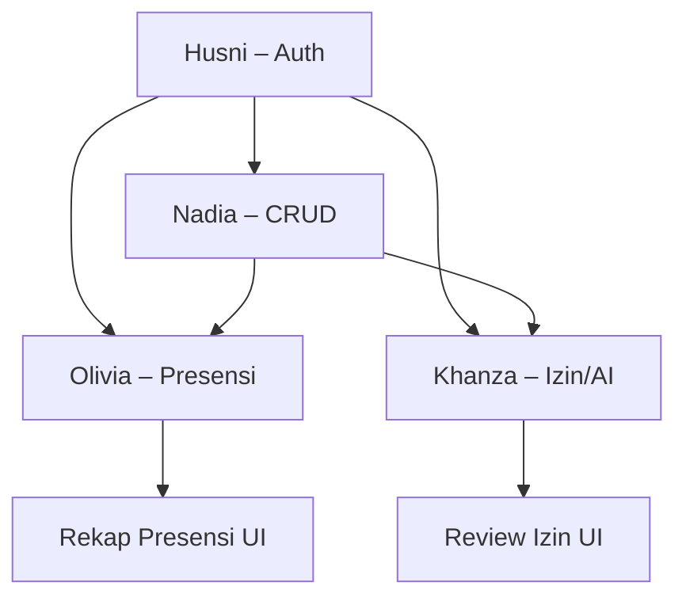

# SOFTWARE REQUIREMENTS SPECIFICATION (SRS)
# TandaIU — Dokumen Terpadu Sprint 1, Sprint 2, dan Sprint 3

**Status:** Dokumen gabungan dari baseline Sprint 1, dokumen Sprint 2, dan spesifikasi Sprint 3  
**Tanggal penggabungan:** 20 November 2026

## Panduan membaca dokumen

Dokumen ini menggabungkan tiga tahap pengembangan TandaIU. Setiap sprint ditampilkan sebagai bagian tersendiri agar konteks, kebutuhan, dan pembagian tugasnya tidak tercampur.

- **Sprint 1** berisi baseline kebutuhan prototipe awal. Naskah sumber dipertahankan tanpa penulisan ulang.
- **Sprint 2** berisi pengembangan autentikasi, CRUD praktikum, presensi realtime, serta pengajuan izin dan AI-sentimen. Naskah sumber dipertahankan tanpa penulisan ulang.
- **Sprint 3** berisi pengembangan presensi berbasis lokasi, pengelolaan laboratorium, Maps, informasi aktivitas laboratorium, dan push notification.

### Ketentuan kode kebutuhan

Kode kebutuhan pada Sprint 1 dan Sprint 2 dipertahankan sesuai dokumen sumber. Karena penomoran `SRS-01` sampai `SRS-16` pada Sprint 2 sudah digunakan, kebutuhan baru Sprint 3 menggunakan awalan **S3-SRS** agar tidak tertukar. Kode dan isi kebutuhan Sprint 1 maupun Sprint 2 tidak diubah.

### Hubungan antarsprint

Sprint berikutnya mengembangkan sistem dari hasil sprint sebelumnya. Pernyataan batasan pada Sprint 1, misalnya penggunaan data lokal dan belum adanya autentikasi, merupakan batasan prototipe pada tahap tersebut. Batasan itu bukan larangan untuk mengembangkan Firebase, autentikasi, dan sinkronisasi pada Sprint 2. Demikian pula, fitur lokasi, Maps, dan notifikasi menjadi perluasan pada Sprint 3.

---

# BAGIAN I — SPRINT 1

**Acuan:** dokumen baseline SRS versi 1.0, tanggal 21 Oktober 2026.  
**Peran bagian ini:** mempertahankan kebutuhan awal prototipe dan pembagian pekerjaan sebagaimana naskah sumber.

---

### SRS.md

# SRS dan Pembagian Tugas Programmer

## Aplikasi Presensi Praktikum — Prototipe React Native

**Versi:** 1.0 **Tanggal:** 21 Oktober 2026 **Status:** Baseline untuk diskusi kebutuhan dan sprint

## 1. Tujuan dan ruang lingkup

Aplikasi mobile ini membantu **asisten** membuka dan menutup sesi praktikum serta memantau presensi, dan membantu **praktikan** melihat jadwal, melakukan presensi, serta melihat riwayat kehadirannya. Hasil sprint adalah prototipe React Native yang dapat didemonstrasikan dari kedua sudut pandang pada satu aplikasi.

Satu sprint ditargetkan selesai **maksimal empat hari setelah kegiatan praktikum**. Minggu persiapan dipakai untuk menyepakati kebutuhan dan kontrak data. Tanggal kegiatan praktikum belum diberikan, sehingga rencana kerja memakai H (hari praktikum) dan H+1 sampai H+4.

### 1.1 Batasan yang berasal dari studi kasus

- Data jadwal, sesi, dan praktikan bersifat **lokal/dummy**; perubahan cukup dikelola dengan React state.
- Tidak diperlukan server, basis data, login sungguhan, atau sinkronisasi antarperangkat.
- Dua sudut pandang harus dapat dicoba melalui pemilihan peran dalam aplikasi. Pengguna praktikan dipilih dari data dummy agar identitas presensi tetap konsisten.
- Status sesi harus langsung tercermin pada layar yang menggunakan state yang sama. Penyelarasan data presensi antara perangkat asisten dan perangkat praktikan **tidak diwajibkan** oleh catatan studi kasus. Untuk demo pada satu proses aplikasi, state bersama dianjurkan agar alur lengkap mudah terlihat.
- Data state boleh kembali ke kondisi awal saat aplikasi dimuat ulang; persistensi tidak termasuk ruang lingkup.

### 1.2 Di luar ruang lingkup sprint

Autentikasi dan otorisasi produksi, GPS/QR, bukti foto, persetujuan izin/sakit, ekspor laporan, notifikasi, administrasi jadwal, backend, dan sinkronisasi real-time antarperangkat.

## 2. Pemangku kepentingan dan istilah

| Istilah   | Arti                                                                                         |
| --------- | -------------------------------------------------------------------------------------------- |
| Asisten   | Pengguna demo yang mengelola status sesi dan melihat rekap kehadiran.                        |
| Praktikan | Pengguna demo yang melakukan presensi dan melihat riwayatnya sendiri.                        |
| Jadwal    | Rencana praktikum yang memuat nama praktikum, kelas, waktu, dan sesi terkait.                |
| Sesi      | Pelaksanaan satu jadwal dengan status `terjadwal`, `dibuka`, atau `ditutup`.                 |
| Presensi  | Satu catatan kehadiran untuk pasangan `sessionId` dan `practikanId`, dengan waktu kehadiran. |

## 3. Asumsi dan keputusan kerja

1. Prototipe menggunakan **Expo + React Native + TypeScript** dan navigasi berbasis **Expo Router** sesuai rujukan yang diberikan. Android menjadi perangkat demo utama; ini keputusan implementasi, bukan syarat eksplisit pada catatan studi kasus.
2. Sesi yang ditutup tidak dapat dibuka lagi dalam sprint ini. Perubahan status mengikuti `terjadwal` → `dibuka` → `ditutup`.
3. Data awal minimal memuat **dua sesi** (satu terjadwal dan satu sesi lain untuk menguji daftar/riwayat) dan **dua praktikan**. Nilai nama, kelas, serta tanggalnya adalah contoh dan disepakati saat kickoff.
4. Waktu kehadiran diambil dari jam perangkat **pada saat tombol konfirmasi presensi ditekan**, disimpan sebagai timestamp ISO, dan ditampilkan dalam format tanggal/jam lokal.
5. Asisten demo adalah satu identitas dummy. Praktikan memilih satu identitas dummy melalui form/pilihan sebelum masuk ke halaman praktikan. Identitas yang dipilih dipakai untuk pemeriksaan presensi ganda dan filter riwayat.
6. Jika arah dosen/asisten pengampu berbeda, PM memperbarui baseline ini sebelum pengerjaan fitur terkait. Asumsi di atas tidak boleh diam-diam dianggap sebagai kutipan persyaratan studi kasus.

## 4. Alur pengguna dan navigasi

```
Pemilihan peran
├─ Asisten → Daftar jadwal → Detail sesi → Buka/Tutup sesi
│                                   └→ Rekap presensi
└─ Praktikan (pilih identitas) → Daftar jadwal → Detail sesi → Presensi
                                             └→ Riwayat pribadi
```

Navigasi harus memungkinkan kembali dari detail/rekap/riwayat ke daftar dan berpindah peran untuk demo. Saat pindah peran dalam proses aplikasi yang sama, state sesi tetap ada. Tombol dan judul halaman mengikuti peran agar aksi asisten tidak muncul di layar praktikan.

## 5. Kebutuhan fungsional

Prioritas **Wajib** berarti harus ada pada demo sprint. Kolom **PIC** menunjukkan satu programmer yang bertanggung jawab memastikan kebutuhan selesai. Pekerjaan pendukung dan berkasnya dirinci pada bagian 11–13.

| ID    | PIC         | Kebutuhan                                                                                                      | Kriteria penerimaan                                                                                                                                                                                        |
| ----- | ----------- | -------------------------------------------------------------------------------------------------------------- | ---------------------------------------------------------------------------------------------------------------------------------------------------------------------------------------------------------- |
| FR-01 | Olivia (P1) | Pengguna dapat memilih sudut pandang asisten atau praktikan. Pada praktikan, pengguna memilih identitas dummy. | Memilih peran membuka halaman yang tepat; identitas praktikan aktif terlihat; saat kembali dan berpindah peran, aksi mengikuti peran yang baru.                                                            |
| FR-02 | Husni (P2)  | Kedua peran dapat melihat daftar jadwal.                                                                       | Setiap item menampilkan nama praktikum, kelas, waktu, dan status sesi; menekan item membuka detail sesi yang sesuai.                                                                                       |
| FR-03 | Husni (P2)  | Kedua peran dapat melihat detail sesi.                                                                         | Detail menampilkan nama praktikum, kelas, waktu, status, dan petunjuk/aksi sesuai peran serta status terkini.                                                                                              |
| FR-04 | Nabila (P3) | Asisten dapat membuka sesi yang berstatus `terjadwal`.                                                         | Aksi memakai konfirmasi; setelah disetujui status menjadi `dibuka`, label/tombol berubah, dan layar terkait dalam proses aplikasi yang sama membaca status baru. Pembatalan tidak mengubah status.         |
| FR-05 | Nabila (P3) | Asisten dapat menutup sesi yang berstatus `dibuka`.                                                            | Aksi memakai konfirmasi; setelah disetujui status menjadi `ditutup`; tombol presensi tidak aktif dan sesi tidak dapat dibuka lagi. Pembatalan tidak mengubah status.                                       |
| FR-06 | Nadia (P4)  | Praktikan dapat melakukan presensi hanya ketika sesi `dibuka`.                                                 | Praktikan memilih/menetapkan identitas, menekan aksi presensi, mengonfirmasi, lalu menerima umpan balik berhasil; catatan memuat `sessionId`, `praktikanId`, dan waktu kehadiran.                          |
| FR-07 | Nadia (P4)  | Sistem mencegah presensi ganda pada satu sesi untuk satu praktikan.                                            | Setelah berhasil sekali, aksi presensi untuk kombinasi identitas dan sesi yang sama menjadi tidak aktif atau memberi pesan sudah presensi; jumlah catatan tetap satu. Praktikan lain masih dapat presensi. |
| FR-08 | Nabila (P3) | Asisten dapat melihat rekap sederhana per sesi.                                                                | Rekap menampilkan daftar praktikan yang hadir dan waktu kehadirannya; jumlah hadir sesuai jumlah catatan unik untuk sesi itu.                                                                              |
| FR-09 | Nadia (P4)  | Praktikan dapat melihat catatan kehadirannya sendiri.                                                          | Riwayat hanya memuat catatan milik identitas aktif, dengan nama praktikum/kelas dan waktu hadir; catatan praktikan lain tidak tampil.                                                                      |
| FR-10 | Husni (P2)  | Aplikasi memberi keadaan kosong dan petunjuk yang jelas.                                                       | Daftar tanpa jadwal, rekap tanpa presensi, dan riwayat tanpa catatan tidak menjadi layar kosong tanpa penjelasan; sebelum sesi dibuka dan setelah ditutup, alasan presensi tidak tersedia terlihat.        |
| FR-11 | Olivia (P1) | Aplikasi memakai form/pilihan, modal konfirmasi/informasi, dan navigasi antarhalaman.                          | Pilihan peran/identitas dapat dioperasikan; buka/tutup/presensi meminta konfirmasi; tombol batal dan tombol kembali bekerja.                                                                               |
| FR-12 | Olivia (P1) | Perubahan data lokal merender ulang layar yang terkait.                                                        | Sesudah buka, presensi, dan tutup pada satu proses aplikasi, daftar/detail/rekap/riwayat menampilkan nilai terbaru tanpa memuat ulang aplikasi.                                                            |

### 5.1 Aturan bisnis dan transisi status

| Kondisi awal               | Aksi                             | Hasil                                                     |
| -------------------------- | -------------------------------- | --------------------------------------------------------- |
| `terjadwal`                | Asisten membuka sesi             | `dibuka`                                                  |
| `dibuka`                   | Asisten menutup sesi             | `ditutup`                                                 |
| `terjadwal` atau `ditutup` | Praktikan mencoba presensi       | Ditolak; tidak membuat catatan                            |
| `dibuka`, belum hadir      | Praktikan mengonfirmasi presensi | Satu catatan baru dengan waktu perangkat                  |
| `dibuka`, sudah hadir      | Praktikan mengulang presensi     | Ditolak; catatan awal tidak berubah                       |
| Status lain/aksi berulang  | Buka atau tutup sesi             | Tidak mengubah status; tampilkan keadaan aksi yang sesuai |

Pemeriksaan aturan bisnis dilakukan pada fungsi pengubah state, bukan hanya dengan menonaktifkan tombol, supaya aksi berulang cepat tetap tidak membuat catatan ganda.

## 6. Data dan kontrak antarmodul

Model minimum yang disepakati sebelum implementasi:

```
type SessionStatus = 'terjadwal' | 'dibuka' | 'ditutup';

type PracticumSession = {
  id: string;
  practicumName: string;
  className: string;
  startsAt: string; // ISO 8601
  endsAt: string;   // ISO 8601
  status: SessionStatus;
};

type Praktikan = { id: string; name: string; studentCode?: string };

type Attendance = {
  sessionId: string;
  praktikanId: string;
  attendedAt: string; // ISO 8601
};
```

State minimum: `sessions`, `praktikans`, `attendances`, `activeRole`, dan `activePraktikanId`. Nama tipe dan berkas final boleh disesuaikan bersama sebelum coding, tetapi semua anggota harus memakai **satu kontrak**. Mutasi yang tersedia: `openSession(id)`, `closeSession(id)`, dan `checkIn(sessionId, praktikanId)`; masing-masing mengembalikan hasil berhasil/gagal beserta alasan untuk umpan balik UI. Daftar rekap dan riwayat diturunkan dari `attendances`, bukan disimpan sebagai salinan terpisah.

Data dummy boleh berisi sesi kosong dan presensi kosong sebagai skenario pengujian. Jika ada tombol reset demo, tombol itu bersifat tambahan, bukan syarat penerimaan.

## 7. Kebutuhan antarmuka dan kualitas

| ID     | Kebutuhan terukur                                                                                                                                              | Cara verifikasi                                                                       |
| ------ | -------------------------------------------------------------------------------------------------------------------------------------------------------------- | ------------------------------------------------------------------------------------- |
| UI-01  | Tata letak menggunakan Flexbox dan tetap terbaca pada layar Android kecil serta layar yang lebih lebar; teks dan tombol tidak terpotong pada orientasi potret. | Pemeriksaan visual pada minimal dua ukuran layar/emulator.                            |
| UI-02  | Gaya antarlayar konsisten dengan `StyleSheet.create` atau pola style terpusat; warna status disertai teks, bukan warna saja.                                   | Review UI daftar, detail, rekap, riwayat, dan modal.                                  |
| UI-03  | Tombol aksi utama terlihat jelas, mempunyai label tindakan, dan kondisi nonaktif disertai alasan.                                                              | Uji manual pada tiap status sesi.                                                     |
| UI-04  | Waktu hadir tampil dengan format lokal yang konsisten dan jelas.                                                                                               | Bandingkan waktu perangkat saat presensi dengan tampilan rekap/riwayat.               |
| NFR-01 | Prototipe dapat dijalankan secara lokal pada Android melalui alur Expo yang dipilih tim tanpa layanan jaringan aplikasi.                                       | Jalankan demo setelah dependensi proyek terpasang; alur utama berhasil tanpa backend. |
| NFR-02 | Perubahan state terlihat segera setelah aksi pada proses aplikasi yang sama.                                                                                   | Jalankan alur demo dan periksa daftar/detail/rekap/riwayat.                           |
| NFR-03 | Tidak ada crash pada daftar kosong, identitas belum dipilih, pembatalan modal, atau aksi berulang.                                                             | Uji skenario negatif dan kosong pada bagian 8.                                        |

## 8. Skenario uji penerimaan

| ID    | Langkah ringkas                                                                                | Hasil yang diharapkan                                                                       | Cakupan             |
| ----- | ---------------------------------------------------------------------------------------------- | ------------------------------------------------------------------------------------------- | ------------------- |
| AT-01 | Pilih asisten → buka daftar → detail sesi terjadwal.                                           | Data dan status pada daftar/detail cocok.                                                   | FR-01–03            |
| AT-02 | Buka sesi; batalkan sekali, lalu konfirmasi.                                                   | Batal tidak mengubah status; konfirmasi mengubah ke `dibuka`.                               | FR-04, FR-11–12     |
| AT-03 | Pindah ke praktikan A → buka detail sesi tadi → presensi.                                      | Aksi tersedia; ada konfirmasi, waktu hadir, dan pesan berhasil.                             | FR-01, FR-06, FR-12 |
| AT-04 | Praktikan A menekan presensi lagi.                                                             | Tidak ada catatan kedua; tampil keadaan sudah presensi.                                     | FR-07               |
| AT-05 | Pindah ke asisten → buka rekap sesi.                                                           | A muncul tepat satu kali dengan waktu hadir.                                                | FR-08, FR-12        |
| AT-06 | Pindah ke praktikan B → lihat riwayat, lalu presensi pada sesi terbuka.                        | Riwayat awal B tidak menampilkan milik A; B dapat presensi; riwayat B menampilkan miliknya. | FR-06, FR-09        |
| AT-07 | Asisten menutup sesi; praktikan mencoba melihat detail lagi.                                   | Status `ditutup`; aksi presensi tidak tersedia dan alasannya jelas.                         | FR-05, FR-06, FR-12 |
| AT-08 | Lihat sesi terjadwal, rekap kosong, riwayat kosong, dan daftar jadwal kosong melalui data uji. | Ada pesan keadaan kosong/belum dibuka; aplikasi tidak crash.                                | FR-10, NFR-03       |
| AT-09 | Jalankan alur pada dua ukuran layar Android.                                                   | Konten dan modal dapat dibaca serta tombol dapat ditekan.                                   | UI-01–03            |

## 9. Keterlacakan dan referensi teknis

| Butir studi kasus                  | ID SRS              |
| ---------------------------------- | ------------------- |
| Jadwal dan detail sesi             | FR-02, FR-03        |
| Buka/tutup sesi                    | FR-04, FR-05, FR-12 |
| Presensi dan cegah duplikasi       | FR-06, FR-07        |
| Rekap dan riwayat                  | FR-08, FR-09        |
| Form, modal, navigasi              | FR-01, FR-11        |
| Data dummy dan state               | FR-12, bagian 6     |
| Flexbox, responsif, kondisi kosong | FR-10, UI-01–03     |

Referensi implementasi resmi (diakses 21 Oktober 2026):

- [React Fundamentals — komponen, props, state/useState](https://reactnative.dev/docs/intro-react)
- [Layout with Flexbox — ](https://reactnative.dev/docs/flexbox)[`flexDirection`](https://reactnative.dev/docs/flexbox)[, ](https://reactnative.dev/docs/flexbox)[`alignItems`](https://reactnative.dev/docs/flexbox)[, ](https://reactnative.dev/docs/flexbox)[`justifyContent`](https://reactnative.dev/docs/flexbox)
- [Handling Text Input — ](https://reactnative.dev/docs/handling-text-input)[`TextInput`](https://reactnative.dev/docs/handling-text-input)[ dan state input](https://reactnative.dev/docs/handling-text-input)
- [Modal — dialog dan ](https://reactnative.dev/docs/modal)[`onRequestClose`](https://reactnative.dev/docs/modal)
- [Style — ](https://reactnative.dev/docs/style)[`style`](https://reactnative.dev/docs/style)[ dan ](https://reactnative.dev/docs/style)[`StyleSheet.create`](https://reactnative.dev/docs/style)
- [Expo: Add navigation — Expo Router, stack, dan tab](https://docs.expo.dev/tutorial/add-navigation/)

## 10. Definisi selesai sprint

SRS dianggap terpenuhi bila FR-01 sampai FR-12 dan AT-01 sampai AT-09 lulus pada demo Android, aplikasi dapat dijalankan dengan perintah `npm install` dan `npx expo start`, tidak ada crash pada alur utama, dan PM telah menerima hasil integrasi. Laporan akhir mencatat setiap kebutuhan yang belum lulus beserta alasannya; kebutuhan tidak dihapus diam-diam untuk menyesuaikan hasil.

## 11. Anggota tim dan penanggung jawab

Satu FR memiliki **satu PIC** yang bertanggung jawab menyelesaikan perilaku dan menunjukkan bukti uji. Kolom pendukung di bagian 12 menunjukkan anggota yang menyediakan kontrak, state, atau komponen untuk PIC. PM menyetujui hasil, bukan menjadi pengganti programmer suatu FR.

| Kode | Nama dan NIM sesuai data yang diberikan PM | Modul utama                                                         | FR yang menjadi tanggung jawab akhir |
| ---- | ------------------------------------------ | ------------------------------------------------------------------- | ------------------------------------ |
| P1   | **Olivia Oktaviani — 24060124120050**      | Fondasi proyek, navigasi, identitas demo, data dummy, state bersama | FR-01, FR-11, FR-12                  |
| P2   | **Husni Ulyaa Khanifah — 24060124120021**  | Daftar jadwal, detail sesi, keadaan kosong, konsistensi tampilan    | FR-02, FR-03, FR-10                  |
| P3   | **Nabila Kayla Rafa — 24060124120022**     | Buka/tutup sesi dan rekap asisten                                   | FR-04, FR-05, FR-08                  |
| P4   | **Nadia Azura Nurhaniya — 24060124120019** | Presensi dan riwayat praktikan                                      | FR-06, FR-07, FR-09                  |

**Catatan administrasi:** NIM Nabila pada naskah sumber tertulis `2406012412002` (13 digit) dan dikoreksi menjadi `24060124120022` mengikuti data Sprint 3 serta pola 14 digit NIM anggota lain. PM perlu memastikannya dengan yang bersangkutan sebelum dokumen diserahkan secara resmi.

## 12. Matriks pekerjaan rinci per kebutuhan SRS

| ID    | PIC             | Yang dikerjakan dan diserahkan                                                                                                                                                                              | Pendukung / dependensi                                                                                      | Bukti selesai                                                                  |
| ----- | --------------- | ----------------------------------------------------------------------------------------------------------------------------------------------------------------------------------------------------------- | ----------------------------------------------------------------------------------------------------------- | ------------------------------------------------------------------------------ |
| FR-01 | **Olivia (P1)** | Buat halaman pilih peran dan pilihan identitas praktikan dummy; simpan `activeRole` dan `activePraktikanId`; arahkan ke rute peran yang dipilih dan sediakan cara kembali/ganti peran.                      | Nadia memakai identitas aktif; Husni membaca peran untuk detail.                                            | AT-01 dan perpindahan peran pada AT-03/06; identitas tidak tertukar.           |
| FR-02 | **Husni (P2)**  | Buat layar daftar jadwal dengan kartu berisi nama praktikum, kelas, waktu, status, dan tautan ke detail berdasarkan ID sesi.                                                                                | Olivia menyediakan tipe, seed `sessions`, dan rute.                                                         | AT-01; setiap item membuka sesi yang tepat.                                    |
| FR-03 | **Husni (P2)**  | Buat layar detail yang membaca sesi berdasarkan ID dan menampilkan informasi penuh serta area aksi sesuai peran/status; sediakan tempat memasang komponen aksi asisten/praktikan.                           | Nabila memasok aksi asisten; Nadia memasok aksi presensi; Olivia memasok state.                             | AT-01 dan AT-07; status terbaru terlihat setelah kembali ke detail.            |
| FR-04 | **Nabila (P3)** | Buat tombol **Buka sesi**, modal konfirmasi/batal, panggil `openSession(id)`, tampilkan pesan hasil, dan cegah aksi pada status selain `terjadwal`.                                                         | Olivia mengimplementasikan fungsi transisi pada state; Husni memasang area aksi pada detail.                | AT-02; batal tidak mengubah status, konfirmasi mengubahnya sekali.             |
| FR-05 | **Nabila (P3)** | Buat tombol **Tutup sesi**, modal konfirmasi/batal, panggil `closeSession(id)`, tampilkan status akhir, dan cegah penutupan berulang.                                                                       | Olivia menyediakan fungsi transisi; Nadia memastikan presensi tidak tersedia sesudah tutup.                 | AT-07; status `ditutup` dan tidak ada presensi baru.                           |
| FR-06 | **Nadia (P4)**  | Buat aksi presensi praktikan, konfirmasi, pesan berhasil/gagal, serta tampilan waktu hadir. Gunakan identitas aktif dan panggil `checkIn(sessionId, praktikanId)` hanya ketika sesi dibuka.                 | Olivia menyediakan identitas, state, dan fungsi `checkIn`; Husni menyediakan detail sesi.                   | AT-03 dan AT-06; catatan memuat pasangan ID dan waktu.                         |
| FR-07 | **Nadia (P4)**  | Tampilkan kondisi **Sudah presensi**, nonaktifkan/ubah aksi, dan pastikan pesan duplikasi jelas. Uji dua identitas berbeda pada sesi yang sama.                                                             | Olivia wajib menolak duplikasi di fungsi `checkIn`, bukan hanya di UI.                                      | AT-04; pasangan ID yang sama tetap satu catatan, praktikan B masih bisa hadir. |
| FR-08 | **Nabila (P3)** | Buat halaman rekap per sesi dari `attendances`: gabungkan nama praktikan, format waktu hadir, dan jumlah hadir; jangan simpan rekap sebagai state kedua.                                                    | Olivia menyediakan data/selector; Nadia menghasilkan catatan presensi; Husni menautkan dari detail.         | AT-05; nama/waktu muncul tepat sekali dan jumlah sesuai.                       |
| FR-09 | **Nadia (P4)**  | Buat halaman riwayat yang memfilter `attendances` dengan `activePraktikanId`, lalu tampilkan praktikum, kelas, dan waktu hadir.                                                                             | Olivia menyediakan identitas aktif dan data sesi; Husni menyediakan pola kartu tampilan bila dipakai.       | AT-06; riwayat B tidak memuat catatan A.                                       |
| FR-10 | **Husni (P2)**  | Susun pola pesan keadaan kosong dan pastikan daftar kosong, sesi belum dibuka, serta sesi ditutup memberi petunjuk. Tinjau pesan kosong pada rekap dan riwayat sebelum integrasi.                           | Nabila menerapkan rekap kosong; Nadia menerapkan riwayat kosong dan alasan presensi nonaktif.               | AT-08; semua keadaan kosong terbaca tanpa crash.                               |
| FR-11 | **Olivia (P1)** | Pastikan rute daftar/detail/rekap/riwayat, tombol kembali, pemilihan peran/identitas, dan pola modal terhubung dalam satu alur demo.                                                                        | Nabila membuat modal buka/tutup; Nadia membuat modal presensi; Husni menyediakan tautan dari daftar/detail. | AT-01–03 dan AT-07; modal dapat batal, navigasi tidak tersesat.                |
| FR-12 | **Olivia (P1)** | Sediakan satu sumber state lokal dan mutasi `openSession`, `closeSession`, `checkIn` dengan hasil `{ ok, reason }`; pastikan layar membaca state terbaru dan transisi/duplikasi ditolak pada fungsi mutasi. | Husni, Nabila, Nadia memakai state yang sama tanpa menyimpan salinan status atau daftar presensi.           | AT-02–07; perubahan terlihat setelah berpindah layar tanpa reload.             |

### 12.1 Pembagian kebutuhan UI dan kualitas

| ID           | PIC utama                                    | Pekerjaan dan pemeriksaan                                                                                                                                                         |
| ------------ | -------------------------------------------- | --------------------------------------------------------------------------------------------------------------------------------------------------------------------------------- |
| UI-01, UI-02 | **Husni (P2)**                               | Menetapkan pola Flexbox/StyleSheet dan komponen jadwal/status; Olivia, Nabila, Nadia menerapkan pola itu pada layar masing-masing. Husni memeriksa dua ukuran Android bersama PM. |
| UI-03        | **Husni (P2)**                               | Menetapkan gaya tombol/teks status; Nabila dan Nadia memastikan tombol aksi masing-masing punya label dan alasan ketika tidak tersedia.                                           |
| UI-04        | **Olivia (P1)**                              | Menetapkan fungsi format waktu lokal bersama; Nabila dan Nadia memakainya pada rekap/riwayat.                                                                                     |
| NFR-01       | **Olivia (P1)**                              | Menjaga proyek dapat dijalankan melalui `npm install` dan `npx expo start`, serta menjelaskan batasan data lokal saat serah terima.                                               |
| NFR-02       | **Olivia (P1)**                              | Memeriksa state bersama dan alur pindah peran; tiap pemilik layar memperbaiki tampilan yang tidak membaca nilai terbaru.                                                          |
| NFR-03       | **Masing-masing pemilik layar; PM menerima** | Husni menguji daftar kosong, Nabila rekap kosong/modal batal, Nadia riwayat kosong/identitas belum dipilih/aksi berulang, Olivia memastikan aplikasi tidak crash saat navigasi.   |

## 13. Batas berkas dan kontrak integrasi

Ini **rencana kepemilikan**, bukan daftar berkas yang sudah ada. Olivia membuat kerangka terlebih dahulu. Sebelum empat orang mulai coding, tim menyepakati nama rute, bentuk tipe pada bagian 6, serta hasil fungsi mutasi. Perubahan kontrak setelah itu perlu diumumkan kepada semua pemilik layar.

| Area implementasi yang direncanakan                                               | Pemilik    | Serah terima kepada anggota lain                                                                        |
| --------------------------------------------------------------------------------- | ---------- | ------------------------------------------------------------------------------------------------------- |
| `src/types/`, `src/data/`, `src/state/`, `src/app/_layout.tsx`, layar pilih peran | **Olivia** | Tipe, seed, hook/provider state, tiga fungsi mutasi, dan daftar rute dapat diimpor anggota lain.        |
| `src/features/schedule/`, layar daftar/detail, komponen kartu/status bersama      | **Husni**  | Detail menyediakan tempat aksi sesuai peran; API props komponen bersama terdokumentasi.                 |
| `src/features/assistant/`, layar rekap, modal buka/tutup                          | **Nabila** | Komponen aksi menerima `sessionId`/status dan memakai fungsi mutasi Olivia; rekap membaca data terbaru. |
| `src/features/praktikan/`, layar riwayat, modal/aksi presensi                     | **Nadia**  | Komponen aksi menerima `sessionId` dan identitas aktif; riwayat membaca data terbaru.                   |

**Aturan integrasi:** identitas praktikan memakai ID stabil, bukan nama. Fungsi mutasi menguji status dan duplikasi sebelum memperbarui state. Rekap dan riwayat dihitung dari `attendances`. Anggota yang membuat layar menguji layar tersebut dan menyerahkan ringkasan perubahan serta cara mencobanya kepada PM.

## 14. Jadwal kerja sampai H+4

| Waktu                 | Olivia (P1)                                       | Husni (P2)                          | Nabila (P3)                           | Nadia (P4)                          | PM                                                |
| --------------------- | ------------------------------------------------- | ----------------------------------- | ------------------------------------- | ----------------------------------- | ------------------------------------------------- |
| **Minggu persiapan**  | Sepakati tipe, rute, fungsi mutasi                | Sepakati layar dan komponen bersama | Sepakati aksi/rekap asisten           | Sepakati identitas/presensi/riwayat | Finalisasi SRS, nama, data contoh, perangkat demo |
| **H / kickoff**       | Buat proyek, seed, state, rute dasar              | Buat rangka daftar/detail           | Buat rangka aksi dan rekap            | Buat rangka aksi dan riwayat        | Pastikan kontrak disetujui semua anggota          |
| **H+1**               | FR-01 dan state FR-12 siap dipakai                | FR-02/03 tampak dengan data dummy   | Modal buka/tutup terhubung ke kontrak | Presensi terhubung ke kontrak       | Tinjau alur awal dan hambatan                     |
| **H+2**               | Rapikan transisi, duplikasi, navigasi             | Lengkapi FR-10 dan gaya bersama     | Selesaikan FR-04/05/08                | Selesaikan FR-06/07/09              | Cek tiap FR terhadap matriks bagian 12            |
| **H+3**               | Integrasi dan perbaikan state/rute                | Uji visual dan keadaan kosong       | Uji asisten dan perbaikan             | Uji praktikan dan perbaikan         | Jalankan AT-01–AT-09; catat bug dan pemiliknya    |
| **H+4 paling lambat** | Jalankan ulang proyek dan perbaiki hambatan setup | Perbaikan tampilan akhir            | Perbaikan alur asisten akhir          | Perbaikan alur praktikan akhir      | Uji ulang, terima hasil, siapkan demo             |

Target H+4 mengikuti catatan studi kasus. Tanggal kalender diisi PM setelah tanggal praktikum diketahui. Integrasi dilakukan sejak H+1 agar masalah antarperan tidak baru muncul pada hari terakhir.

## 15. Pemeriksaan dan serah terima kepada PM

| Pemeriksaan | Penyiap utama                                                        | Penerima |
| ----------- | -------------------------------------------------------------------- | -------- |
| AT-01       | Olivia + Husni                                                       | PM       |
| AT-02       | Nabila + Olivia                                                      | PM       |
| AT-03–04    | Nadia + Olivia                                                       | PM       |
| AT-05       | Nabila                                                               | PM       |
| AT-06       | Nadia                                                                | PM       |
| AT-07       | Nabila + Nadia + Olivia                                              | PM       |
| AT-08       | Husni mengoordinasikan; Nabila dan Nadia menguji layar masing-masing | PM       |
| AT-09       | Husni; seluruh pemilik layar memperbaiki temuan                      | PM       |

Urutan demo utama: **asisten membuka sesi → praktikan A presensi → asisten melihat rekap → asisten menutup sesi**. Sesudah itu tunjukkan cegah presensi ganda, riwayat praktikan B, dan keadaan kosong. PM mencatat hasil nyata setiap AT sebagai *lulus*, *gagal*, atau *belum diuji*, lalu mengembalikan kegagalan kepada PIC pada bagian 12.

## 16. Keputusan PM yang masih perlu diisi

| Keputusan                                          | Kondisi saat ini                                                 |
| -------------------------------------------------- | ---------------------------------------------------------------- |
| Tanggal praktikum (H) dan tanggal kalender H+4     | Belum diberikan                                                  |
| Nama praktikum, kelas, jadwal, dan identitas dummy | Perlu disepakati saat kickoff                                    |
| Perangkat/emulator Android untuk demonstrasi       | Belum ditentukan                                                 |
| Verifikasi NIM Nabila | Dikoreksi dari `2406012412002` menjadi `24060124120022` mengikuti data Sprint 3; mohon konfirmasi dengan yang bersangkutan |

---

# BAGIAN II — SPRINT 2

**Periode pada dokumen sumber:** 13 November 2026 – 17 November 2026.  
**Peran bagian ini:** mempertahankan pembagian programmer, SRS, kontrak data/helper, batas folder, dependensi, dan proses integrasi Sprint 2 sebagaimana naskah sumber.

---

# Sprint 2 – TandaIU  
**Periode:** 13 Nov 2026 – 17 Nov 2026 (berakhir 23:59 WIB)  

Dokumen ini berisi **pembagian tugas**, **SRS**, **kontrak data & helper**, **struktur folder‑isolasi**, serta **check‑list merge** yang Anda (PM) hanya perlu *merge* PR‑PR. Semua hal di‑setup supaya tiap programmer dapat bekerja **independen** tanpa menunggu orang lain dan tanpa menimbulkan **merge conflict**.

---  

## 1. Ringkasan Tim & Branches  

| Programmer | Fokus utama | Branch Git |
|------------|--------------|-----------|
| **Husni Ulyaa Khanifah** | Auth & Role Management (login/registrasi/guard) | `feature/sprint-2-auth-role` |
| **Olivia Oktaviani** | Presensi realtime (buka/tutup sesi, check‑in, rekap) | `feature/sprint-2-presensi-realtime` |
| **Nadia Azura Nurhaniya** | CRUD kelas, jadwal, sesi + Security Rules | `feature/sprint-2-crud-praktikum` |
| **Khanza Qaila** | Pengajuan izin + AI‑sentimen (klasifikasi, review) | `feature/sprint-2-izin-ai` |

> **Catatan PM:** Anda hanya men‑merge PR‑PR di urutan yang tercantum pada bagian **6. Merge Process**.

---  

## 2. Deadline & Goal  

| Item | Target |
|------|--------|
| **Selesai semua fitur** | Selasa 17 Nov 2026 23:59 WIB |
| **CI** | `npm test`, `npx expo lint`, `npx expo doctor` all **green** |
| **Release tag** | `sprint-2-complete` (setelah semua merge) |

---  

## 3. Data Dummy – Single Source of Truth  

> Semua programmer **harus** mengambil data dari file‑file di bawah ini; **jangan** men‑hardcode nilai lain.  

| File (path) | Isi (ringkas) |
|-------------|---------------|
| `src/data/assistantIdentity.ts` | ```ts export const assistantIdentity = { name: 'Lily Collins', studentCode: '24060124123450', role: 'assistant', } as const; ``` |
| `src/data/praktikans.ts` | ```ts export const praktikans: Praktikan[] = [ { id:'p1', name:'Andi Pratama', studentCode:'24060124120001', semester:3 }, { id:'p2', name:'Budi Santoso', studentCode:'24060124120002', semester:1 }, /* … */ ]; ``` |
| `src/data/dosen.ts` | ```ts export const dosen = [ { id:'dos-01', name:'Nurul Hidayati, S.Kom., M.Kom.', nip:'199002142015122006' }, { id:'dos-02', name:'Dimas Setiawan, S.Kom., M.Cs.', nip:'199105112016121009' }, ] as const; ``` |
| `src/data/courses.ts` | (sama dengan sprint 1 – tidak diubah) |
| `src/data/sessions.ts` | ```ts export const initialSessions: PracticumSession[] = [ { id:'s5', courseId:'struktur-data', practicumName:'Struktur Data', className:'C1', lecturer:'Nurul Hidayati, S.Kom., M.Kom.', startsAt:'2026-10-27T08:00:00+07:00', endsAt:'2026-10-27T10:00:00+07:00', status:'dibuka' }, { id:'s6', courseId:'manajemen-basis-data', practicumName:'Manajemen Basis Data', className:'B2', lecturer:'Dimas Setiawan, S.Kom., M.Cs.', startsAt:'2026-10-27T13:00:00+07:00', endsAt:'2026-10-27T15:10:00+07:00', status:'terjadwal' }, ]; ``` |
| `src/data/attendances.ts` | `export const initialAttendances: Attendance[] = []; // akan di‑isi oleh presensi` |
| `src/data/permits.ts` | ```ts export const dummyPermits = [ { id:'perm-01', sessionId:'s5', studentId:'p1', studentName:'Andi Pratama', reason:'Demam tinggi, harus istirahat.', review:'Materi jelas, dosen ramah.', sentiment:'positif', status:'pending', createdAt:new Date().toISOString(), }, ]; ``` |

> **PM:** commit semua file ini ke `main` **sebelum** tim memulai pengerjaan (commit “baseline‑sprint‑2”).

---  

## 4. Helper / Contract API (Zero‑Dependency)

### 4.1. `src/lib/firebase.ts` – Inisialisasi Firebase  

```ts
import { initializeApp } from 'firebase/app';
import { getAuth } from 'firebase/auth';
import { getFirestore } from 'firebase/firestore';

const firebaseConfig = {
  apiKey: process.env.EXPO_PUBLIC_FIREBASE_API_KEY,
  authDomain: process.env.EXPO_PUBLIC_FIREBASE_AUTH_DOMAIN,
  projectId: process.env.EXPO_PUBLIC_FIREBASE_PROJECT_ID,
  storageBucket: process.env.EXPO_PUBLIC_FIREBASE_STORAGE_BUCKET,
  messagingSenderId: process.env.EXPO_PUBLIC_FIREBASE_MESSAGING_SENDER_ID,
  appId: process.env.EXPO_PUBLIC_FIREBASE_APP_ID,
};

const app = initializeApp(firebaseConfig);
export const auth = getAuth(app);
export const db = getFirestore(app);
```

*Semua modul* (`authService`, `attendanceService`, `permitService`, …) **import** `auth`/`db` **dari sini**.

---

### 4.2. `src/lib/currentSession.ts` – User‑Context (Mock + Real)

```ts
import { auth } from './firebase';
import { User } from 'firebase/auth';

export interface CurrentUser {
  uid: string;
  name: string;
  email: string;
  role: 'assistant' | 'praktikan';
  studentCode?: string;
}

/**
 * Return real user if Firebase Auth is active,
 * otherwise return the dummy user defined in src/data/praktikans.ts.
 */
export function getCurrentUser(): CurrentUser {
  const firebaseUser = auth.currentUser as User | null;

  if (firebaseUser) {
    // In production you would also fetch the role from Firestore `users/{uid}`
    return {
      uid: firebaseUser.uid,
      name: firebaseUser.displayName ?? 'unknown',
      email: firebaseUser.email ?? '',
      role: 'praktikan', // will be overwritten later by a service call
    };
  }

  // ---------- MOCK MODE ----------
  // Used by Olivia & Khanza while Husni is still working on real auth.
  return {
    uid: 'p1',
    name: 'Andi Pratama',
    email: 'andi.pratama@students.undip.ac.id',
    role: 'praktikan',
    studentCode: '24060124120001',
  };
}
```

> **Catatan:** Ketika Husni selesai, **hanya** fungsi `getCurrentUser()` yang akan di‑update – tidak ada perubahan di kode programmer lain.

---

### 4.3. `src/lib/aiClient.ts` – AI Sentimen (Mock + Real)

```ts
/**
 * Analisa sentimen ulasan praktikan.
 * Jika endpoint AI tersedia, ubah `FAKE_API_URL` ke URL sebenarnnya.
 * Jika tidak, fallback ke rule kata‑kunci (positif/negatif/netral).
 */
export async function analyzeSentiment(
  text: string,
): Promise<'positif' | 'netral' | 'negatif'> {
  const FAKE_API_URL = ''; // <- isi ketika API sudah ada

  if (FAKE_API_URL) {
    try {
      const resp = await fetch(FAKE_API_URL, {
        method: 'POST',
        headers: { 'Content-Type': 'application/json' },
        body: JSON.stringify({ text }),
      });
      const json = await resp.json();
      return json.sentiment; // ekspektasi {sentiment:'positif'|...}
    } catch (e) {
      console.warn('AI call failed → fallback to mock');
    }
  }

  // ---- MOCK FALLBACK ----
  await new Promise((r) => setTimeout(r, 600)); // simulate latency
  const lower = text.toLowerCase();
  if (lower.includes('bagus') || lower.includes('jelas') || lower.includes('senang')) return 'positif';
  if (lower.includes('kecewa') || lower.includes('sulit') || lower.includes('buruk')) return 'negatif';
  return 'netral';
}
```

> **Khanza** gunakan fungsi ini di `src/services/permitService.ts`. Tidak ada programmer lain yang boleh meng‑hardcode API AI.

---  

## 5. Folder‑Isolation Rules (No‑Conflict Architecture)

```
src/
├─ app/
│   ├─ auth/                     ← Husni
│   │   ├─ login.tsx
│   │   └─ register.tsx
│   ├─ assistant/
│   │   ├─ manage/               ← Nadia (CRUD)
│   │   ├─ attendance/           ← Olivia (Presensi UI)
│   │   └─ permits/              ← Khanza (Izin UI)
│   └─ praktikan/
│       └─ permit/               ← Khanza (Pengajuan UI)
├─ features/
│   ├─ auth/                     ← Husni (hooks, utils)
│   ├─ crud/                     ← Nadia
│   ├─ attendance/               ← Olivia
│   └─ permit/                   ← Khanza
├─ services/
│   ├─ authService.ts            ← Husni
│   ├─ practicumService.ts       ← Nadia
│   ├─ attendanceService.ts      ← Olivia
│   └─ permitService.ts          ← Khanza
├─ lib/
│   ├─ firebase.ts               ← PM / Husni (read‑only)
│   ├─ currentSession.ts         ← PM (read‑only)
│   └─ aiClient.ts               ← PM (read‑only)
└─ data/
    ├─ assistantIdentity.ts
    ├─ praktikans.ts
    ├─ dosen.ts
    ├─ courses.ts
    ├─ sessions.ts
    ├─ attendances.ts
    └─ permits.ts
```

**Rule:** *Only the owner folder may be edited.*  
Jika ada keperluan mengubah file di `src/lib` atau `src/data`, **PM** melakukannya dan memberi label **read‑only** pada PR.

---  

## 6. SRS & Deliverables per Programmer  

### 6.1. Husni Ulyaa Khanifah – Auth & Role  

| SRS Kode | User‑Story |
|----------|------------|
| **SRS‑01** | Sebagai **Pengguna**, saya dapat **registrasi** dengan email, password, nama, dan memilih peran (praktikan / asisten) sehingga data akun tersimpan di `users/{uid}`. |
| **SRS‑02** | Sebagai **Pengguna**, saya dapat **login** dengan email & password dan diarahkan ke dashboard yang sesuai peran. |
| **SRS‑03** | Sebagai **Pengguna**, saya dapat **logout** sehingga sesi berakhir dan kembali ke layar login. |
| **SRS‑04** | Sebagai **Aplikasi**, semua layar kecuali `/auth/*` harus menolak akses bila tidak login atau role tidak cocok (guard). |

**Deliverable**  
- `src/lib/firebase.ts` (baseline)  
- UI login/register (`src/app/auth/*`)  
- `src/components/ProtectedRoute.tsx`  
- `src/services/authService.ts` (signIn, signUp, signOut)  
- Unit‑test (`src/__tests__/auth.*`)  

**Acceptance** (semua harus lulus)  
1. Registrasi menyimpan dokumen `users/{uid}` dengan field `{uid, name, email, role, studentCode}`.  
2. Login → guard mengizinkan akses sesuai role.  
3. Logout → kembali ke `/auth/login`.  
4. Guard menolak akses bila tidak authorized.  
5. `npm test` & `npx expo lint` bersih.  

---  

### 6.2. Nadia Azura Nurhaniya – CRUD & Security  

| SRS Kode | User‑Story |
|----------|------------|
| **SRS‑05** | Sebagai **Asisten**, saya dapat **CRUD** data kelas, jadwal, dan sesi praktikum. |
| **SRS‑06** | Saat membuat sesi, saya wajib memilih **dosen pengampu** (Nurul Hidayati atau Dimas Setiawan). |
| **SRS‑07** | Sebagai **Sistem**, security‑rules harus membatasi **write** hanya untuk user dengan `role=="assistant"`; **read** di‑izinkan untuk semua user ter‑autentikasi. |

**Deliverable**  
- Type definitions `src/types/praktikum.ts` (kelas, jadwal, sesi).  
- Hooks `src/hooks/useClasses.ts`, `useSchedules.ts`, `useSessions.ts` (real‑time `onSnapshot`).  
- UI CRUD (`src/app/assistant/manage/*`).  
- `firestore.rules` (final versi).  
- Unit‑test `src/__tests__/crud.*`.  

**Acceptance**  
1. Asisten dapat **tambah / edit / hapus** tanpa error.  
2. Praktikan hanya **read** (coba write → Firestore rules menolak).  
3. Perubahan terlihat realtime di UI lain.  
4. Security rules diuji dengan `firebase emulators:exec "npm test"` dan lulus.  

---  

### 6.3. Olivia Oktaviani – Presensi Realtime  

| SRS Kode | User‑Story |
|----------|------------|
| **SRS‑08** | Sebagai **Asisten**, saya dapat **membuka** sesi (status = “dibuka”) dan **menutup** sesi (status = “ditutup”). |
| **SRS‑09** | Sebagai **Praktikan**, saya dapat **presensi satu kali** pada sesi yang “dibuka”. |
| **SRS‑10** | Semua pihak dapat **melihat rekap presensi realtime** (nama, waktu, status) tanpa reload. |
| **SRS‑11** | Sistem menolak **presensi ganda** pada sesi yang sama. |

**Deliverable**  
- Service `src/services/attendanceService.ts` (open/close session, check‑in, listener).  
- UI `src/app/assistant/attendance/*` & `src/app/praktikan/attendance.tsx`.  
- Component `src/components/AttendanceSummary.tsx`.  
- Unit‑test `src/__tests__/attendance.*`.  

**Acceptance**  
1. Asisten “Buka” → `sessions/{id}.status = "dibuka"` terlihat di semua client.  
2. Praktikan menekan **Presensi**, data `attendances/{uid}` tercipta, tidak bisa lagi menekan.  
3. Jika sesi “ditutup”, tombol **disabled**.  
4. Rekap tabel menampilkan semua kehadiran secara realtime.  
5. Semua tes lulus, lint bersih.  

---  

### 6.4. Khanza Qaila – Izin & AI  

| SRS Kode | User‑Story |
|----------|------------|
| **SRS‑12** | Praktikan dapat **mengajukan izin** dengan alasan; data tersimpan di `permits/{permitId}`. |
| **SRS‑13** | Sistem mengirim **alasan** ke AI, menerima **sentimen** (positif/negatif/netral) dan menyimpannya bersama izin. |
| **SRS‑14** | Asisten dapat **melihat semua izin** beserta sentimen AI, dan **menyetujui / menolak** permohonan. |
| **SRS‑15** | Praktikan dapat melihat **status izin** secara realtime. |
| **SRS‑16** | Sistem harus **menangani kegagalan AI** (fallback ke “netral” atau “unknown”) tanpa memutus alur. |

**Deliverable**  
- Service `src/services/permitService.ts` (create, update status, listener).  
- UI `src/app/praktikan/permit.tsx` (form) & `src/app/assistant/permits.tsx` (review table).  
- Hook `src/hooks/usePermit.ts`.  
- Unit‑test `src/__tests__/permit.*`.  

**Acceptance**  
1. Form izin menyimpan dokumen `permits/{id}` lengkap dengan `sentiment`.  
2. AI dipanggil via `analyzeSentiment()`; bila gagal, `sentiment = "netral"` dan UI menampilkan warning.  
3. Asisten melihat tabel izin + sentimen; dapat ubah status menjadi `approved` / `rejected`.  
4. Praktikan melihat perubahan status secara realtime.  
5. Semua tes lulus, lint bersih.  

---  

## 7. Dependency‑Map (visual)  



*Setiap panah* berarti **fungsi helper** (`getCurrentUser`, `firebase`, `aiClient`) atau **koleksi Firestore** (`sessions`, `permits`) yang sudah disepakati. Karena semua helper berada di `src/lib/*`, tidak ada file yang saling menimpa.

---  

## 8. Merge Process (PM‑Only)

| Langkah | Kapan | Apa yang dilakukan | Checklist |
|--------|------|--------------------|-----------|
| **0️⃣ Baseline** | Jumat 13 Nov (awal) | Pastikan commit baseline sudah di `main` (helper, dummy data, stub `_layout.tsx`). | ☐ `main` berisi semua file di §2‑§4.<br> ☐ Semua anggota `git pull origin main`. |
| **1️⃣ Review Auth** | Sab 14 Nov (setelah Husni push) | - Approve PR `feature/sprint-2-auth-role`.<br>- Pastikan tidak ada perubahan di folder selain `src/app/auth/**`, `src/features/auth/**`, `src/services/authService.ts`. | ☐ CI **green**.<br> ☐ Tidak ada file di luar scope. |
| **2️⃣ Review CRUD** | Sab/Min 14‑15 Nov (setelah Nadia push) | - Approve PR `feature/sprint-2-crud-praktikum`.<br>- Pastikan `firestore.rules` hanya menambah rule, tidak menghapus yang ada. | ☐ CI **green**.<br> ☐ Rule `allow write: if request.auth.token.role == 'assistant'`. |
| **3️⃣ Review Presensi** | Min 15 Nov (setelah Olivia push) | - Approve PR `feature/sprint-2-presensi-realtime`.<br>- Pastikan tidak ada perubahan di folder milik yang lain. | ☐ CI **green**.<br> ☐ Tidak mengubah `src/app/auth/**` atau `src/app/assistant/manage/**`. |
| **4️⃣ Review Izin/AI** | Sen 16 Nov (setelah Khanza push) | - Approve PR `feature/sprint-2-izin-ai`.<br>- Pastikan `src/lib/aiClient.ts` **tidak** di‑ubah (hanya dipanggil). | ☐ CI **green**.<br> ☐ Tidak mengubah helper. |
| **5️⃣ Merge Urutan** | Sen 16 Nov (setelah semua PR di‑approve) | 1️⃣ Merge `auth` → `crud` → `presensi` → `izin`. <br> Setelah tiap merge, **pull** `main` dan jalankan `npm test` sekali untuk memastikan tidak ada regresi. | ☐ Semua PR merged tanpa konflik.<br> ☐ Semua tes lulus setelah tiap merge. |
| **6️⃣ Final Security Rules** | Sel 17 Nov (pagi) | Pastikan `firestore.rules` (yang sudah di‑update Nadia) ada di `main`. Tag commit `v2-security-rules`. | ☐ Rules ter‑deploy ke Firebase (emulator atau console). |
| **7️⃣ End‑to‑End Smoke Test** | Sel 17 Nov (siang) | Jalankan aplikasi di Expo Go: <br>• Login as Asisten → buka sesi → login Praktikan → presensi → Asisten lihat rekap. <br>• Praktikan → ajukan izin → Asisten review → Praktikan lihat status. | ☐ Semua alur berfungsi, tidak ada error. |
| **8️⃣ Tag Release** | Sel 17 Nov 23:59 | Buat tag `sprint-2-complete` & release notes (link ke dokumen ini). | ☐ Tag & changelog tersedia di GitHub. |
| **9️⃣ Deadline** | Sel 17 Nov 23:59 WIB | Pastikan **tidak ada PR terbuka** dan semua CI **green**. | ☐ Semua selesai, siap dipresentasikan. |

> **PM hanya men‑merge** – tidak meng‑edit kode lain. Jika ada konflik (mis. karena seseorang mengubah file di luar folder yang diberikan), **tolak PR** dan minta pemilik file memperbaikinya.

---  

## 9. Timeline Ringkas (4 hari)

| Hari | Aktivitas Utama |
|------|-----------------|
| **Jum 13 Nov** | - Push baseline (helper, dummy data, stub layout). <br> - Semua dev `git pull`. |
| **Sab 14 Nov** | - Husni selesai *Auth* → PR & merge. <br> - Nadia mulai *CRUD* (branch). |
| **Min 15 Nov** | - Nadia push *CRUD* → PR & merge. <br> - Olivia & Khanza mulai masing‑masing (presensi & izin). |
| **Sen 16 Nov** | - Olivia push *Presensi* → PR & merge. <br> - Khanza push *Izin/AI* → PR & merge. |
| **Sel 17 Nov** | - Final security rules, smoke test, tag release, deadline. |

---  

## 10. Risiko & Mitigasi  

| Risiko | Dampak | Mitigasi |
|--------|--------|----------|
| **Edit `_layout.tsx` oleh lebih dari satu orang** | Konflik besar saat merge | *Day 0* hanya PM yang men‑add stub routes; semua dev **tidak** memperbolehkan perubahan di file ini. |
| **Package version mismatch** (mis. `firebase` atau UI lib) | Build error | Semua dev menjalankan `npx expo install firebase` **setelah** baseline dipush; versi dicatat di `package.json`. |
| **Penambahan field baru di koleksi tanpa kesepakatan** | Data inconsistency | Semua struktur koleksi didefinisikan di **kontrak** (§2) dan di‑document di `README`; perubahan harus melalui PR PM. |
| **Security Rules tidak sinkron** | Data breach atau write‑blocked | Nadia yang menulis `firestore.rules`; PR di‑review oleh Husni (auth) & PM. |
| **AI endpoint belum tersedia** | Timeout / error | `aiClient.ts` menyediakan mock fallback; UI menampilkan warning bila fallback dipakai. |

---  

## 11. Checklist untuk Setiap Programmer (untuk dipasang di issue)

- [ ] **Branch** dibuat dengan nama yang tepat.  
- [ ] **Folder** hanya mengandung file yang menjadi tanggung jawab (lihat §5).  
- [ ] **Import** helper (`firebase`, `currentSession`, `aiClient`) – **jangan** duplicate kode.  
- [ ] **Unit‑test** minimal satu test untuk setiap hook/service.  
- [ ] **Lint & Type‑check** bersih (`npm run lint && npx tsc --noEmit`).  
- [ ] **Push** ke remote, buka PR, beri label **ready‑for‑review**.  

---  

## 12. Penutup  

Dengan **baseline data**, **helper contract**, **folder‑isolasi**, serta **merge checklist** di atas, semua anggota tim dapat:

1. **Mulai coding** pada hari yang sama tanpa menunggu orang lain.  
2. **Menulis kode** yang tidak menimpa file milik rekan.  
3. **Menyelesaikan PR** yang dapat langsung Anda (PM) **merge** satu per satu.  

Semoga Sprint 2 berjalan lancar dan selesai tepat waktu! 🚀

---

# BAGIAN III — SPRINT 3

**Fokus:** Presensi Berbasis Lokasi, Pengelolaan Laboratorium, Maps, Informasi Aktivitas Laboratorium, dan Push Notification  
**Versi:** Revisi 20 November 2026  
**Status:** Spesifikasi kebutuhan Sprint 3

## 1. Pendahuluan

### 1.1 Tujuan

Dokumen ini menjelaskan kebutuhan perangkat lunak TandaIU pada Sprint 3 sebagai acuan implementasi, pembagian tugas programmer, integrasi antarmodul, dan pengujian fitur.

### 1.2 Ruang Lingkup

Sprint 3 mengembangkan fitur presensi praktikum berbasis lokasi laboratorium. Sistem memungkinkan praktikan melakukan presensi ketika sesi dibuka dan posisi perangkat berada dalam radius laboratorium yang ditentukan. Validasi sesi, radius, dan presensi ganda dilakukan pada saat presensi dicatat di sisi backend, bukan hanya pada tampilan aplikasi.

Sprint ini juga mencakup pengelolaan lokasi laboratorium oleh asisten, hubungan antara sesi dan laboratorium, tampilan Maps yang menunjukkan lokasi laboratorium dan posisi pengguna, informasi praktikum yang sedang berlangsung maupun berikutnya, rekap kehadiran bagi asisten, serta push notification untuk perubahan aktivitas praktikum dan hasil pengajuan izin.

Fitur autentikasi, pengelolaan akun, CRUD kelas dan jadwal, mekanisme dasar presensi, serta pengajuan izin dari Sprint sebelumnya tetap menggunakan implementasi yang sudah tersedia. Sprint 3 hanya melakukan penyesuaian pada bagian yang diperlukan untuk integrasi fitur baru.

Di luar ruang lingkup Sprint 3: presensi menggunakan QR Code (fitur opsional pada tugas), penghapusan data laboratorium, dan navigasi atau pelacakan rute pada Maps.

### 1.3 Tujuan Pengembangan

1. Membatasi presensi berdasarkan lokasi laboratorium, dengan validasi di sisi backend.
2. Memudahkan asisten mengelola lokasi dan radius laboratorium.
3. Menghubungkan setiap sesi praktikum dengan laboratorium tempat sesi berlangsung.
4. Menampilkan lokasi laboratorium dan posisi pengguna melalui Maps.
5. Menampilkan informasi praktikum berdasarkan jadwal dan sesi yang tersimpan.
6. Memberikan pemberitahuan otomatis kepada pengguna terkait aktivitas praktikum.
7. Memberikan rekap kehadiran kepada asisten, termasuk informasi lokasi presensi.
8. Menangani kegagalan izin perangkat, lokasi, jaringan, dan notifikasi.

### 1.4 Asumsi

1. Aplikasi dibangun dengan React Native, Firebase Authentication, Cloud Firestore, dan Firebase Cloud Messaging (FCM), mengikuti teknologi yang telah digunakan pada repository.
2. Validasi presensi dan pengiriman push notification memerlukan logika backend (misalnya Cloud Functions). Ketersediaan paket Firebase yang mendukung hal ini harus dipastikan pada awal sprint. Jika tidak tersedia, tim menyepakati alternatif secara tertulis sebelum implementasi.
3. API key layanan Maps dan kredensial lain dikelola di luar repository.

## 2. Pengguna Sistem

| Aktor | Hak akses dan aktivitas |
|---|---|
| Asisten | Mengelola lokasi laboratorium, menentukan laboratorium sesi, melihat informasi laboratorium, membuka sesi praktikum melalui fitur yang sudah tersedia, dan melihat rekap kehadiran. |
| Praktikan | Melakukan presensi berdasarkan lokasi, melihat Maps dan informasi praktikum, serta menerima notifikasi. |
| Sistem (backend) | Memvalidasi presensi saat dicatat dan mengirim push notification ketika terjadi perubahan data yang relevan. |

## 3. Pembagian Tugas Programmer

Setiap anggota memiliki empat kebutuhan fungsional (total 16). Rekap kehadiran asisten tercakup pada S3-SRS-01 dan hubungan sesi dengan laboratorium pada S3-SRS-08.

| Anggota | Programmer | NIM | Fokus | Kode kebutuhan |
|---|---|---|---|---|
| Anggota 1 | Husni Ulyaa Khanifah | 24060124120021 | Halaman presensi, validasi lokasi backend, dan rekap kehadiran asisten | S3-SRS-01–S3-SRS-04 |
| Anggota 2 | Khanza Qaila | 24060124120011 | Pengelolaan lokasi dan radius laboratorium serta hubungan sesi dengan laboratorium | S3-SRS-05–S3-SRS-08 |
| Anggota 3 | Nabila Kayla Rafa | 24060124120022 | Maps dan informasi aktivitas laboratorium | S3-SRS-09–S3-SRS-12 |
| Anggota 4 | Nadia Azura Nurhaniya | 24060124120019 | Push notification dan penanganan kegagalan notifikasi serta jaringan | S3-SRS-13–S3-SRS-16 |

## 4. Kebutuhan Fungsional

### 4.1 Halaman Presensi, Validasi Lokasi, dan Rekap Kehadiran — Anggota 1

#### S3-SRS-01 — Halaman Presensi dan Rekap Kehadiran Asisten

Sistem harus menyediakan halaman presensi khusus bagi praktikan yang terpisah dari halaman detail sesi praktikum. Halaman menampilkan informasi praktikum, kelas, waktu, laboratorium, radius presensi, status sesi, serta tombol presensi sesuai kondisi sesi. Sistem juga harus menyediakan rekap kehadiran per sesi bagi asisten dengan memperluas fitur rekap yang sudah ada jika tersedia.

Kriteria penerimaan:
- Praktikan dapat membuka halaman presensi.
- Informasi sesi dan laboratorium ditampilkan.
- Halaman tidak menggantikan halaman detail sesi yang sudah tersedia.
- Asisten dapat melihat daftar praktikan yang berhasil melakukan presensi pada suatu sesi beserta waktu presensi.
- Rekap menampilkan informasi lokasi presensi, misalnya jarak dari laboratorium.
- Presensi yang ditolak tidak muncul sebagai kehadiran berhasil.
- Rekap memperbarui diri ketika ada presensi baru yang berhasil dicatat.
- Rekap hanya dapat diakses oleh asisten yang berwenang.

#### S3-SRS-02 — Pemeriksaan Status Sesi

Sistem harus memeriksa status sesi sebelum mengizinkan praktikan melakukan presensi.

Kriteria penerimaan:
- Presensi hanya dapat dilakukan ketika sesi berstatus dibuka.
- Jika sesi ditutup, tombol presensi tidak dapat digunakan.
- Status sesi mengikuti data yang tersimpan di sistem dan diperiksa ulang di backend saat presensi dicatat.
- Aturan pembukaan sesi (siapa dan kapan sesi dapat dibuka) mengikuti implementasi Sprint sebelumnya dan tidak diubah pada Sprint 3.

#### S3-SRS-03 — Pengambilan Lokasi Perangkat

Sistem harus meminta izin akses lokasi perangkat untuk memperoleh koordinat praktikan ketika melakukan presensi.

Kriteria penerimaan:
- Sistem meminta izin lokasi sesuai mekanisme perangkat.
- Sistem dapat memperoleh koordinat latitude dan longitude ketika izin diberikan.
- Pengambilan lokasi memiliki batas waktu 15 detik. Jika terlampaui, sistem menampilkan pesan dan opsi mencoba lagi.
- Koordinat dengan akurasi lebih buruk dari 50 meter tidak dipakai untuk presensi; praktikan diminta mencoba lagi.
- Jika izin ditolak, layanan lokasi mati, atau koordinat tidak tersedia, sistem menampilkan pesan yang sesuai dengan jenis kegagalan.
- Sistem tidak menganggap lokasi yang gagal diperoleh sebagai lokasi valid.

#### S3-SRS-04 — Validasi Radius Laboratorium di Backend

Sistem harus memeriksa jarak antara koordinat praktikan dan koordinat laboratorium berdasarkan radius yang telah dikonfigurasi. Pemeriksaan ini merupakan bagian dari proses pencatatan presensi, bukan sekadar informasi visual pada antarmuka.

Kriteria penerimaan:
- Aplikasi mengirim koordinat perangkat dan identitas sesi ke backend; backend menentukan hasil presensi.
- Identitas praktikan diambil dan diverifikasi backend dari Firebase Authentication (akun terautentikasi pengirim permintaan), bukan dari data yang dikirim client. Permintaan tanpa autentikasi yang valid ditolak.
- Backend juga memverifikasi bahwa akun pengirim memiliki role praktikan sebelum menerima presensi. Akun asisten atau akun tanpa role praktikan ditolak, sehingga tidak dapat dipakai untuk membuat presensi sebagai praktikan.
- Backend mengambil role berdasarkan UID pengguna yang telah terautentikasi dari sumber data role yang tepercaya, misalnya dokumen `users/{uid}` di Firestore atau Firebase Custom Claims. Backend tidak boleh menggunakan role yang dikirim oleh client sebagai dasar otorisasi, termasuk nilai role dari helper `getCurrentUser()` pada sisi aplikasi (Sprint 2), yang masih berupa mock dan bernilai bawaan `praktikan`.
- Backend mengambil koordinat dan radius laboratorium dari Firestore, bukan dari data yang dikirim client, lalu menghitung jarak menggunakan rumus Haversine.
- Presensi dicatat berhasil hanya jika sesi berstatus dibuka, jarak tidak melebihi radius, dan praktikan belum melakukan presensi pada sesi yang sama.
- Presensi ditolak dan tidak dicatat sebagai kehadiran berhasil jika jarak melebihi radius, sesi tidak dibuka, atau presensi ganda.
- Client tidak dapat menulis data kehadiran berhasil secara langsung tanpa melalui validasi backend. Jika diperlukan perubahan Firestore Rules, perubahan dikoordinasikan sesuai Bagian 8.1.
- Koordinat dari mock location ditolak apabila platform atau library dapat mendeteksinya.
- Data presensi berhasil menyimpan koordinat, jarak ke laboratorium (distanceMeters), akurasi lokasi (accuracyMeters), dan waktu presensi jika field tersebut belum tersedia, agar dapat digunakan oleh rekap pada S3-SRS-01.
- Aplikasi menampilkan hasil pemeriksaan: jarak ke laboratorium, radius yang berlaku, dan alasan ketika presensi tidak dapat dilakukan.
- Mekanisme backend (Cloud Functions callable atau mekanisme setara) dipilih tim pada awal sprint dan dikoordinasikan dengan Nadia karena memakai infrastruktur backend yang sama.

### 4.2 Pengelolaan Lokasi Laboratorium dan Hubungan dengan Sesi — Anggota 2

#### S3-SRS-05 — Menambahkan Lokasi Laboratorium

Sistem harus memungkinkan asisten menambahkan data laboratorium yang terdiri dari nama laboratorium, koordinat lokasi, dan radius presensi.

Kriteria penerimaan:
- Asisten dapat memasukkan nama laboratorium.
- Asisten dapat memasukkan atau menentukan koordinat latitude dan longitude.
- Latitude harus berada pada rentang -90 sampai 90 dan longitude pada rentang -180 sampai 180.
- Nama laboratorium tidak boleh kosong dan tidak boleh sama dengan laboratorium lain.
- Radius presensi wajib diisi saat laboratorium ditambahkan (nilai mengikuti S3-SRS-07); laboratorium tanpa radius tidak dapat dipakai untuk presensi.
- Sistem memvalidasi kelengkapan dan kewajaran data sebelum disimpan.

#### S3-SRS-06 — Mengelola Data Laboratorium

Sistem harus memungkinkan asisten mengubah informasi laboratorium serta mengaktifkan atau menonaktifkan laboratorium yang sudah terdaftar.

Kriteria penerimaan:
- Asisten yang memiliki hak akses dapat mengubah informasi laboratorium.
- Asisten dapat menonaktifkan laboratorium melalui konfirmasi sebelum perubahan dilakukan.
- Laboratorium yang dinonaktifkan tidak dapat dipilih untuk sesi praktikum baru atau sesi yang sedang diedit.
- Data laboratorium yang dinonaktifkan tetap tersimpan di Firestore dan tidak menghilangkan riwayat sesi yang pernah menggunakan laboratorium tersebut.
- Asisten dapat melihat dan mengaktifkan kembali laboratorium yang sebelumnya dinonaktifkan.
- Perubahan status laboratorium hanya dapat dilakukan oleh asisten yang memiliki hak akses sesuai validasi backend dan Firestore Rules.
- Penghapusan permanen data laboratorium tidak disediakan melalui aplikasi.

#### S3-SRS-07 — Mengatur Radius Laboratorium

Sistem harus memungkinkan asisten menentukan dan mengubah radius presensi setiap laboratorium dalam satuan meter.

Kriteria penerimaan:
- Asisten dapat memasukkan radius laboratorium.
- Nilai radius harus berupa angka positif dan tidak melebihi batas maksimum 500 meter.
- Radius yang tersimpan menjadi acuan validasi lokasi presensi di backend.
- Perubahan radius berlaku pada proses validasi berikutnya.

#### S3-SRS-08 — Penyimpanan Data Laboratorium dan Hubungan Sesi dengan Laboratorium

Sistem harus menyimpan dan mengambil data laboratorium melalui Firebase Firestore agar dapat digunakan oleh fitur presensi dan Maps. Sistem juga harus menghubungkan setiap sesi praktikum dengan satu laboratorium sehingga presensi, Maps, dan informasi aktivitas dapat menentukan lokasi sesi.

Kriteria penerimaan:
- Data laboratorium tersimpan secara persisten dan dapat dibaca kembali oleh pengguna yang memiliki hak akses.
- Akses perubahan data laboratorium dibatasi untuk asisten yang berwenang dan ditegakkan di sisi backend (Firestore Rules), bukan hanya pada tampilan.
- Perubahan data laboratorium dapat digunakan oleh modul presensi dan Maps.
- Setiap sesi menyimpan referensi laboratorium (laboratoryId) pada data sesi yang sudah ada, tanpa membuat koleksi sesi baru.
- Asisten dapat memilih laboratorium ketika membuat atau mengatur sesi; penyesuaian pada form sesi yang sudah ada dilakukan seminimal mungkin dan dikoordinasikan dengan pemilik modul terkait.
- Sesi tanpa laboratorium (misalnya data lama) tidak dapat dipakai untuk presensi dan ditampilkan dengan keterangan yang jelas.
- Data laboratorium pada sesi mengikuti data laboratorium terbaru.

### 4.3 Maps dan Informasi Aktivitas Laboratorium — Anggota 3

#### S3-SRS-09 — Menampilkan Maps Laboratorium

Sistem harus menyediakan halaman Maps yang menampilkan lokasi laboratorium berdasarkan data yang tersimpan di Firestore.

Kriteria penerimaan:
- Peta dapat ditampilkan pada halaman Maps.
- Lokasi laboratorium ditampilkan menggunakan marker.
- Marker berasal dari data laboratorium yang tersimpan, bukan koordinat yang ditulis secara statis di aplikasi.
- Peta memberikan informasi yang sesuai ketika data lokasi belum tersedia atau gagal dimuat.

#### S3-SRS-10 — Menampilkan Posisi Pengguna

Sistem harus menampilkan posisi pengguna pada Maps berdasarkan koordinat perangkat selama halaman Maps aktif.

Kriteria penerimaan:
- Sistem meminta izin lokasi jika diperlukan.
- Posisi pengguna ditampilkan menggunakan marker yang berbeda dari marker laboratorium.
- Posisi diperbarui setiap 5 detik atau ketika terjadi perpindahan minimal 10 meter selama halaman Maps aktif.
- Pembaruan posisi berhenti ketika halaman Maps tidak aktif.
- Jika lokasi tidak tersedia, sistem menampilkan informasi yang sesuai tanpa menyebabkan halaman gagal dibuka, dan marker laboratorium tetap tampil.

#### S3-SRS-11 — Informasi Marker Laboratorium

Sistem harus menampilkan informasi laboratorium ketika pengguna memilih marker laboratorium pada Maps.

Kriteria penerimaan:
- Pengguna dapat memilih marker laboratorium.
- Sistem menampilkan nama laboratorium dan informasi lokasi yang tersedia.
- Informasi praktikum pada S3-SRS-12 ditampilkan pada detail laboratorium yang sama.
- Informasi mengikuti data laboratorium terbaru yang berhasil dimuat.

#### S3-SRS-12 — Informasi Praktikum Berlangsung dan Berikutnya

Sistem harus menampilkan informasi praktikum yang sedang berlangsung dan praktikum berikutnya pada setiap laboratorium, berdasarkan data jadwal dan sesi praktikum yang tersimpan di sistem.

Definisi (status sesi menjadi acuan utama; rentang waktu jadwal hanya pelengkap):
- Praktikum berlangsung: sesi laboratorium tersebut yang berstatus dibuka, sampai sesi ditutup, meskipun waktu saat ini berada di luar rentang jadwalnya.
- Jika tidak ada sesi berstatus dibuka, jadwal yang rentang waktunya mencakup waktu saat ini dan sesinya belum ditutup ditampilkan sebagai berlangsung dengan status sesi apa adanya (misalnya terjadwal atau belum dibuka).
- Sesi berstatus ditutup tidak ditampilkan sebagai berlangsung, meskipun rentang waktu jadwalnya masih berjalan.
- Praktikum berikutnya: jadwal laboratorium tersebut dengan waktu mulai terdekat setelah waktu saat ini, yang sesinya belum dibuka maupun ditutup dan tidak sedang ditampilkan sebagai berlangsung.
- Jika lebih dari satu sesi memenuhi syarat berlangsung pada laboratorium yang sama, semuanya ditampilkan dengan sesi berstatus dibuka di urutan teratas.

Kriteria penerimaan:
- Sistem menampilkan nama praktikum, kelas, waktu pelaksanaan, dan status sesi.
- Informasi ditentukan berdasarkan jadwal dan sesi yang terhubung dengan laboratorium melalui S3-SRS-08.
- Jika tidak ada praktikum berlangsung atau berikutnya, sistem menampilkan keterangan yang sesuai.
- Perubahan jadwal atau status sesi tercermin setelah data terbaru berhasil diterima, dengan target maksimal 5 detik pada jaringan normal.

### 4.4 Push Notification dan Penanganan Kegagalan — Anggota 4

#### S3-SRS-13 — Izin Notifikasi dan Registrasi Perangkat

Sistem harus meminta izin notifikasi dan mengelola token perangkat yang diperlukan untuk mengirim push notification.

Kriteria penerimaan:
- Sistem meminta izin notifikasi sesuai platform, termasuk izin notifikasi runtime pada Android versi terbaru.
- Token perangkat diperoleh ketika proses registrasi berhasil.
- Token dikaitkan dengan akun pengguna yang sedang aktif; satu pengguna dapat memiliki lebih dari satu token (satu per perangkat).
- Token diperbarui ketika berubah.
- Token dihapus atau dinonaktifkan ketika pengguna logout, agar notifikasi tidak sampai ke pengguna yang salah.
- Penolakan izin tidak mengganggu fungsi utama aplikasi.

#### S3-SRS-14 — Notifikasi Aktivitas Praktikum

Sistem harus mengirimkan push notification kepada pengguna yang relevan ketika sesi praktikum dibuka atau jadwal praktikum mengalami perubahan.

Kriteria penerimaan:
- Pengiriman dipicu oleh backend ketika data sesi atau jadwal berubah (misalnya Cloud Functions dengan Firestore trigger dan FCM), bukan oleh aplikasi client.
- Praktikan pada kelas terkait menerima notifikasi ketika sesi praktikum dibuka.
- Pengguna terkait (praktikan pada kelas tersebut) menerima notifikasi ketika jadwal berubah.
- Isi notifikasi memuat informasi yang relevan (nama praktikum, kelas, dan perubahan).
- Notifikasi tidak dikirim kepada pengguna yang tidak berkaitan dengan aktivitas tersebut.
- Menekan notifikasi membuka halaman yang sesuai di aplikasi.
- Notifikasi dapat diterima ketika aplikasi sedang dibuka, berjalan di latar belakang, maupun tertutup.
- Kegagalan pengiriman tidak membatalkan perubahan sesi atau jadwal.

#### S3-SRS-15 — Notifikasi Hasil Pengajuan Izin

Sistem harus mengirimkan push notification kepada praktikan ketika pengajuan izin memperoleh keputusan diterima atau ditolak.

Kriteria penerimaan:
- Pengiriman dipicu oleh backend ketika status pengajuan izin berubah dan berhasil disimpan.
- Praktikan yang mengajukan izin menerima notifikasi ketika izin diterima.
- Praktikan yang mengajukan izin menerima notifikasi ketika izin ditolak.
- Notifikasi memuat status keputusan.
- Menekan notifikasi membuka halaman pengajuan izin terkait.
- Sistem tidak mengubah keputusan izin hanya karena notifikasi gagal dikirim.

#### S3-SRS-16 — Penanganan Kegagalan Notifikasi dan Jaringan

Sistem harus menangani kondisi ketika izin notifikasi ditolak, token perangkat gagal diperoleh, pengiriman notifikasi gagal, atau jaringan bermasalah. Kegagalan izin dan layanan lokasi ditangani oleh pemilik S3-SRS-03 dan S3-SRS-10; S3-SRS-16 menyediakan pola pesan kesalahan bersama yang dapat dipakai modul lain.

Kriteria penerimaan:
- Sistem menampilkan pesan yang sesuai dengan jenis kegagalan.
- Kegagalan lokasi tidak menyebabkan presensi dianggap berhasil (diverifikasi pada S3-SRS-03 dan S3-SRS-04).
- Kegagalan notifikasi tidak membatalkan perubahan data utama.
- Sistem tidak menyimpan token perangkat yang tidak valid sebagai token aktif.
- Gangguan jaringan ditampilkan dengan pesan yang dapat dipahami dan opsi mencoba lagi, tanpa menyebabkan aplikasi berhenti.
- Pengguna tetap dapat menggunakan fitur lain yang tidak bergantung pada layanan yang gagal.

## 5. Aturan Bisnis Sprint 3

1. Praktikan hanya dapat melakukan presensi pada sesi yang berstatus dibuka.
2. Praktikan harus berada dalam radius laboratorium yang ditentukan.
3. Satu praktikan tidak dapat melakukan presensi lebih dari satu kali pada sesi yang sama.
4. Koordinat dan radius laboratorium menjadi acuan validasi presensi.
5. Data lokasi laboratorium hanya dapat dikelola oleh asisten yang memiliki hak akses.
6. Data laboratorium menjadi sumber informasi untuk fitur presensi dan Maps.
7. Posisi pengguna hanya dapat ditampilkan ketika izin dan layanan lokasi tersedia.
8. Informasi praktikum berasal dari data jadwal dan sesi yang tersimpan.
9. Notifikasi hanya dikirim kepada pengguna yang relevan dengan perubahan aktivitas.
10. Kegagalan notifikasi tidak boleh membatalkan transaksi atau perubahan data utama.
11. Sistem tidak boleh menganggap lokasi yang tidak berhasil diperoleh sebagai lokasi yang memenuhi radius.
12. Validasi presensi harus tetap mempertahankan aturan presensi yang sudah diterapkan pada Sprint sebelumnya.
13. Validasi sesi, radius, dan presensi ganda dilakukan di backend pada saat presensi dicatat; pemeriksaan di aplikasi hanya pelengkap tampilan.
14. Sesi yang belum terhubung dengan laboratorium tidak dapat dipakai untuk presensi.

## 6. Kebutuhan Data dan Integrasi

### 6.1 Data Laboratorium

Data laboratorium minimal memiliki atribut:

| Atribut | Keterangan |
|---|---|
| laboratoryId | Identitas laboratorium |
| name | Nama laboratorium |
| latitude | Koordinat lintang |
| longitude | Koordinat bujur |
| radius | Radius presensi dalam meter |
| createdAt | Waktu data dibuat |
| updatedAt | Waktu terakhir data diperbarui |

### 6.2 Integrasi Data Sesi dan Presensi

Data sesi dan presensi menggunakan struktur yang sudah tersedia pada implementasi Sprint sebelumnya. Penyesuaian hanya dilakukan pada hal berikut:

- Data sesi: menambahkan referensi laboratorium (`laboratoryId`) sesuai S3-SRS-08.
- Data presensi: menambahkan latitude, longitude, jarak ke laboratorium (`distanceMeters`), akurasi lokasi (`accuracyMeters`), dan waktu presensi jika belum tersedia untuk mendukung rekap pada S3-SRS-01.

Jangan membuat koleksi atau model baru yang menduplikasi data sesi, jadwal, atau presensi yang sudah tersedia.

### 6.3 Data Token Perangkat

Data token perangkat minimal mencakup:
- Identitas pengguna.
- Token perangkat.
- Platform perangkat.
- Waktu pembaruan token.

Satu pengguna dapat memiliki lebih dari satu token (satu per perangkat). Token dihapus atau dinonaktifkan ketika pengguna logout. Penyimpanan token harus mengikuti struktur akun dan autentikasi yang sudah digunakan oleh aplikasi.

## 7. Kebutuhan Non-Fungsional Sprint 3

**S3-NFR-01 — Kompatibilitas Platform**  
Fitur Sprint 3 harus dapat digunakan pada platform Android dan iOS sesuai dukungan library dan konfigurasi proyek.

**S3-NFR-02 — Keamanan Data**  
Data lokasi laboratorium dan token perangkat hanya dapat diakses atau diubah oleh pengguna sesuai hak aksesnya. Validasi penting (status sesi, radius, presensi ganda, dan hak akses pengelolaan laboratorium) harus ditegakkan di backend dan tidak boleh hanya bergantung pada tampilan frontend.

**S3-NFR-03 — Konsistensi Data**  
Data laboratorium, jadwal, sesi, presensi, dan pengajuan izin harus menggunakan sumber data yang sudah berlaku di aplikasi.

**S3-NFR-04 — Penanganan Kesalahan**  
Kegagalan layanan lokasi, jaringan, atau notifikasi harus ditangani dengan pesan yang dapat dipahami pengguna dan tidak menyebabkan aplikasi berhenti secara tidak semestinya.

**S3-NFR-05 — Pembaruan Informasi**  
Perubahan data yang berkaitan dengan sesi, jadwal, dan laboratorium harus tercermin pada halaman yang menggunakan data tersebut setelah pembaruan berhasil diterima, dalam batas waktu pada Bagian 7.1.

**S3-NFR-06 — Privasi Lokasi**  
Akses lokasi hanya digunakan untuk kebutuhan presensi dan penampilan posisi pengguna pada Maps. Sistem harus meminta izin sebelum mengakses lokasi perangkat.

**S3-NFR-07 — Responsivitas**  
Pengambilan lokasi, pemeriksaan presensi, dan pembaruan Maps harus memberikan umpan balik yang jelas kepada pengguna (indikator memuat, hasil, atau pesan kesalahan) dan mengikuti parameter pada Bagian 7.1.

### 7.1 Parameter Konfigurasi (Nilai Awal Usulan)

| Parameter | Nilai awal | Dipakai pada |
|---|---|---|
| Batas waktu pengambilan lokasi | 15 detik | S3-SRS-03 |
| Akurasi lokasi maksimum untuk presensi | 50 meter | S3-SRS-03, S3-SRS-04 |
| Radius laboratorium maksimum | 500 meter | S3-SRS-07 |
| Pembaruan posisi pengguna di Maps | Setiap 5 detik atau perpindahan minimal 10 meter | S3-SRS-10 |
| Batas waktu perubahan data tercermin | Maksimal 5 detik pada jaringan normal | S3-SRS-12, S3-NFR-05 |

Nilai di atas adalah usulan awal; tim menyepakati dan menyesuaikannya setelah uji di lokasi laboratorium.

## 8. Batasan Implementasi dan Berkas

Pembagian berikut merupakan batas kepemilikan modul. Nama file aktual harus mengikuti struktur yang sudah tersedia pada branch `main` dan diverifikasi sebelum implementasi.

| Programmer | Batas pekerjaan | Batas perubahan |
|---|---|---|
| Husni | Halaman presensi, validasi lokasi, dan rekap kehadiran | Modul halaman presensi praktikan, integrasi layanan presensi/lokasi, validasi presensi di backend, penyimpanan metadata lokasi presensi, dan tampilan rekap asisten. Tidak mengambil alih CRUD laboratorium. |
| Khanza | Pengelolaan laboratorium dan hubungan sesi–laboratorium | Modul data, layanan, dan antarmuka pengelolaan laboratorium, serta penambahan `laboratoryId` pada sesi. Tidak mengubah alur utama presensi atau Maps. |
| Nabila | Maps dan informasi aktivitas | Modul halaman Maps, marker, posisi pengguna, serta informasi praktikum. Tidak mengambil alih pengelolaan data laboratorium. |
| Nadia | Push notification | Modul registrasi token, layanan notifikasi, dan logika backend pemicu notifikasi. Tidak mengubah keputusan izin atau alur sesi yang menjadi milik modul lain. |

### 8.1 Ketentuan Berkas

1. Programmer wajib memeriksa file yang sudah tersedia sebelum membuat file baru.
2. File yang sudah memiliki fungsi serupa harus digunakan kembali atau diperluas jika memungkinkan.
3. Tidak boleh membuat service, model, context, atau koleksi Firestore baru yang menduplikasi implementasi sebelumnya.
4. Perubahan pada file bersama harus dikoordinasikan dengan pemilik modul.
5. File konfigurasi Firebase, autentikasi, navigasi utama, dan Firestore Rules tidak boleh diubah sembarangan.
6. Perubahan Firestore Rules hanya dilakukan jika memang diperlukan oleh kebutuhan Sprint 3 dan harus dikoordinasikan dengan anggota terkait.
7. Tidak boleh menghapus atau mengganti implementasi Sprint sebelumnya yang masih digunakan.
8. File di luar tanggung jawab masing-masing hanya boleh disentuh untuk kebutuhan integrasi yang disepakati.
9. File konfigurasi dan credential tidak boleh memasukkan API key atau secret ke repository.
10. Path file baru harus dikonfirmasi berdasarkan struktur repository sebelum implementasi.
11. Kode backend (misalnya Cloud Functions) dipisahkan per fungsi: validasi presensi dikelola Husni, pemicu notifikasi dikelola Nadia. Konfigurasi backend bersama dikoordinasikan antara keduanya.

## 9. Ketergantungan Antaranggota

1. Husni membutuhkan data koordinat dan radius laboratorium dari modul Khanza untuk melakukan validasi lokasi.
2. Khanza menyediakan data laboratorium yang digunakan oleh modul presensi dan Maps.
3. Nabila membutuhkan data laboratorium dari Khanza untuk menampilkan marker.
4. Nabila membutuhkan data jadwal dan sesi yang sudah tersedia untuk menampilkan aktivitas praktikum.
5. Nadia membutuhkan data pengguna, sesi, jadwal, dan pengajuan izin untuk menentukan penerima notifikasi.
6. Perubahan data yang menjadi sumber notifikasi harus dikoordinasikan dengan pemilik modul terkait.
7. Husni dan Nabila membutuhkan `laboratoryId` pada sesi dari Khanza untuk menentukan lokasi sesi.
8. Husni dan Nadia memakai infrastruktur backend yang sama; pilihan mekanisme backend diputuskan bersama di awal sprint.
9. Khanza menyelesaikan skema laboratorium dan data contoh lebih awal; selama modul Khanza belum selesai, anggota lain memakai data contoh yang sama.
10. Rekap kehadiran pada S3-SRS-01 bergantung pada metadata lokasi presensi yang ditulis oleh validasi S3-SRS-04.

## 10. Pengujian dan Kriteria Penerimaan Sprint 3

| ID | Skenario | Hasil yang diharapkan |
|---|---|---|
| S3-AT-01 | Praktikan membuka halaman presensi | Informasi praktikum tampil |
| S3-AT-02 | Praktikan melakukan presensi ketika sesi ditutup | Presensi ditolak |
| S3-AT-03 | Praktikan memberikan izin lokasi | Koordinat berhasil diperoleh |
| S3-AT-04 | Praktikan menolak izin lokasi | Presensi tidak dapat dilanjutkan |
| S3-AT-05 | Praktikan berada dalam radius | Presensi dapat dilanjutkan jika syarat lain terpenuhi |
| S3-AT-06 | Praktikan berada di luar radius | Presensi ditolak |
| S3-AT-07 | Asisten menambahkan laboratorium | Data berhasil tersimpan |
| S3-AT-08 | Asisten mengubah koordinat atau radius | Data terbaru tersimpan |
| S3-AT-09 | Pengguna membuka Maps | Marker laboratorium tampil |
| S3-AT-10 | Pengguna mengaktifkan lokasi | Marker posisi pengguna tampil |
| S3-AT-11 | Pengguna memilih marker | Informasi laboratorium tampil |
| S3-AT-12 | Jadwal atau sesi berubah | Informasi aktivitas diperbarui |
| S3-AT-13 | Pengguna memberikan izin notifikasi | Token perangkat dapat didaftarkan |
| S3-AT-14 | Sesi praktikum dibuka | Pengguna terkait menerima notifikasi |
| S3-AT-15 | Jadwal praktikum berubah | Pengguna terkait menerima notifikasi |
| S3-AT-16 | Pengajuan izin diterima | Praktikan menerima notifikasi |
| S3-AT-17 | Pengajuan izin ditolak | Praktikan menerima notifikasi |
| S3-AT-18 | Jaringan terputus ketika mengambil data | Sistem menampilkan penanganan kesalahan |
| S3-AT-19 | Pengiriman notifikasi gagal | Data utama tetap tersimpan |
| S3-AT-20 | Izin lokasi atau notifikasi ditolak | Aplikasi tetap dapat digunakan pada fitur lain yang tidak bergantung pada izin tersebut |
| S3-AT-21 | Praktikan berhasil melakukan presensi | Asisten melihat kehadiran beserta waktu dan jarak pada rekap |
| S3-AT-22 | Data presensi dikirim langsung dari client dengan koordinat di luar radius atau tanpa melalui validasi | Backend menolak dan tidak mencatat sebagai hadir |
| S3-AT-23 | Praktikan melakukan presensi dua kali pada sesi yang sama | Presensi kedua ditolak |
| S3-AT-24 | Asisten memilih laboratorium pada sesi | Sesi tersimpan dengan laboratorium; presensi dan Maps memakainya |
| S3-AT-25 | Praktikan membuka sesi yang belum memiliki laboratorium | Presensi tidak dapat dilakukan dan keterangan tampil |
| S3-AT-26 | Lokasi lambat diperoleh atau akurasinya rendah | Pesan dan opsi mencoba lagi tampil; presensi tidak diproses |
| S3-AT-27 | Pengguna logout | Token perangkat dihapus; notifikasi akun lama tidak diterima di perangkat tersebut |
| S3-AT-28 | Pengguna menekan notifikasi | Halaman terkait di aplikasi terbuka |
| S3-AT-29 | Sesi dibuka untuk satu kelas | Hanya praktikan pada kelas tersebut yang menerima notifikasi |
| S3-AT-30 | Laboratorium tidak memiliki praktikum berlangsung atau berikutnya | Keterangan kosong tampil pada informasi laboratorium |
| S3-AT-31 | Client mengirim identitas praktikan lain pada permintaan presensi | Presensi dicatat atas akun yang terautentikasi, bukan identitas kiriman client |
| S3-AT-32 | Tiga kondisi pada laboratorium yang sama: (a) sesi berstatus dibuka di luar rentang jadwal; (b) rentang jadwal sedang berjalan dan sesi belum dibuka; (c) rentang jadwal sedang berjalan tetapi sesi ditutup | (a) tampil sebagai berlangsung; (b) tampil sebagai berlangsung dengan status sesi aslinya (misalnya terjadwal atau belum dibuka); (c) tidak tampil sebagai berlangsung |
| S3-AT-33 | Akun asisten mengirim permintaan presensi | Backend menolak dan tidak mencatat kehadiran |

## 11. Definition of Done Sprint 3

Fitur Sprint 3 dinyatakan selesai apabila:

1. Seluruh kebutuhan fungsional yang menjadi tanggung jawab anggota sudah diimplementasikan.
2. Integrasi dengan modul yang sudah ada berjalan tanpa merusak fitur Sprint sebelumnya.
3. Validasi presensi berdasarkan status sesi, radius laboratorium, dan presensi ganda berjalan di backend.
4. Data laboratorium tersimpan dan dapat digunakan oleh modul terkait, dan setiap sesi terhubung dengan laboratorium.
5. Maps dapat menampilkan lokasi laboratorium dan posisi pengguna sesuai izin.
6. Informasi aktivitas praktikum mengikuti data jadwal dan sesi.
7. Rekap kehadiran asisten menampilkan presensi berhasil beserta informasi lokasinya.
8. Push notification berhasil diuji untuk seluruh jenis pemicu yang ditentukan.
9. Penanganan kondisi gagal sudah diuji.
10. Pengujian frontend, backend, integrasi, dan aturan akses telah dilakukan, dan skenario S3-AT-01 sampai S3-AT-33 dijalankan.
11. Tidak ada credential, file debug, atau file lokal yang tidak diperlukan ikut masuk ke repository.

## 12. Referensi

- Push notification: [Rich Push Notifications in React Native – A Complete Guide](https://medium.com/@silverskytechnology/rich-push-notifications-in-react-native-a-complete-guide-797dd9747366)
- Maps: [Implementing Google Maps and Routes Tracking in React Native – A Starter Guide](https://medium.com/@silverskytechnology/implementing-google-maps-and-routes-tracking-in-react-native-a-starter-guide-9768282594b8)

## 13. Catatan Revisi Sprint 3

- Rekap kehadiran asisten dimasukkan ke S3-SRS-01 (metadata lokasi presensi ditetapkan pada S3-SRS-04), dan hubungan sesi dengan laboratorium dimasukkan ke S3-SRS-08.
- Jumlah kebutuhan fungsional dipertahankan sebanyak 16, dengan pembagian empat kebutuhan untuk setiap anggota.
- Validasi presensi dipertegas berjalan di backend, termasuk pemeriksaan status sesi, radius, dan presensi ganda.
- Pemicu notifikasi ditetapkan di backend, penerima didefinisikan, ditambah navigasi saat notifikasi ditekan; S3-SRS-13 menambah penghapusan token saat logout dan dukungan multi-perangkat.
- Parameter lokasi, Maps, dan pembaruan informasi dibuat terukur sebagai nilai awal usulan.
- Identitas praktikan diverifikasi dari Firebase Authentication, dan role dibaca di backend dari sumber data tepercaya, bukan dari nilai yang dikirim client atau helper `getCurrentUser()` (S3-SRS-04).
- Prioritas penentuan praktikum berlangsung dipertegas pada S3-SRS-12: status sesi diutamakan, rentang jadwal sebagai pelengkap.
- QR Code, penghapusan laboratorium, dan navigasi rute dinyatakan di luar Sprint 3.

---

# BAGIAN IV — KETENTUAN UMUM DOKUMEN

1. Isi Sprint 1 dan Sprint 2 pada dokumen ini dipertahankan dari naskah sumber. Perbedaan format hanya berasal dari penempatan sebagai bagian dokumen terpadu; satu-satunya koreksi isi adalah NIM Nabila pada Sprint 1.
2. Kebutuhan Sprint 3 ditambahkan sebagai perluasan, bukan pengganti kebutuhan sprint sebelumnya.
3. Jika terdapat perubahan requirement, perubahan harus dicatat pada bagian sprint yang bersangkutan dan disetujui pihak yang bertanggung jawab.
4. Kode kebutuhan lama tidak boleh dipakai ulang untuk requirement baru tanpa penanda sprint.
5. Implementasi aktual harus mengikuti struktur dan dependensi repository yang berlaku, bukan menganggap seluruh path yang pernah direncanakan pasti sudah tersedia.

---

# LAMPIRAN — ASUMSI MODUL LABORATORIUM (ANGGOTA 2)

Bagian ini mencatat asumsi yang diambil untuk mengisi hal-hal yang belum ditentukan pada S3-SRS-05 sampai S3-SRS-08. Asumsi bukan kutipan persyaratan; perubahan keputusan harus dicatat di sini dan disetujui pihak yang bertanggung jawab.

## A. Cakupan dan kepemilikan data laboratorium

1. **Laboratorium bersifat global.** Dokumen `laboratories` tidak memiliki pemilik (`assistantUid`) dan tidak terikat pada semester atau semester parity. Alasannya, laboratorium adalah ruangan milik program studi yang dipakai lintas asisten dan lintas semester, sementara validasi presensi seluruh kelas bergantung pada koordinat yang sama.
2. **Laboratorium tidak difilter per semester** pada pembacaan maupun pengelolaan, berbeda dari `classes`, `schedules`, dan `sessions` yang dibatasi `semesterParity`.
3. **"Asisten yang berwenang"** pada S3-SRS-08 dan Aturan Bisnis 5 diartikan sebagai `isAssistant()`: pengguna terautentikasi yang memiliki profil `users/{uid}` valid dengan role `asisten` serta custom claim `assistantSemesterParity` bernilai `ganjil` atau `genap`. Tidak ada peran kepala asisten, koordinator laboratorium, atau claim tambahan.
4. **Firestore Rules koleksi `laboratories`**: pembacaan diizinkan untuk seluruh pengguna yang terautentikasi karena data laboratorium dibutuhkan modul Maps (S3-SRS-09) dan presensi (S3-SRS-04); pembuatan dan perubahan hanya untuk `isAssistant()`. Rules tidak memverifikasi keterkaitan antara asisten dan laboratorium tertentu karena relasi tersebut tidak tersimpan.
5. **Penghapusan laboratorium tidak disediakan** pada antarmuka maupun Rules. SRS Bagian III 1.2 mengecualikan penghapusan data laboratorium, dan penghapusan dapat membuat referensi pada sesi serta riwayat presensi kehilangan titik acuan.
6. **Setiap asisten dapat mengubah laboratorium mana pun**, termasuk yang dibuat asisten lain. Konsekuensinya, tidak ada pembatasan "asisten hanya boleh mengubah laboratorium yang ia ampu".

## B. Atribut dan validasi

7. Atribut laboratorium adalah `name`, `latitude`, `longitude`, `radius`, `lantai`, `createdAt`, dan `updatedAt`. Tidak ada atribut lain seperti gedung, foto, atau keterangan.
8. **`lantai`** ditambahkan sebagai atribut karena SRS 6.1 menyebut daftar atribut sebagai "minimal" dan informasi lantai tidak dapat diturunkan dari data lain. Nilainya bilangan bulat minimal 1; nilai desimal, nol, atau negatif ditolak.
9. **`radius`** berupa bilangan bulat dengan rentang 1 sampai 500 meter. Nilai desimal, nol, negatif, atau di atas 500 ditolak. Nilai 700 meter tidak digunakan pada Sprint 3.
10. **Nama laboratorium wajib diisi dan unik tanpa membedakan huruf besar-kecil** setelah spasi di awal dan akhir dibuang. Keunikan diperiksa pada layanan sebelum data disimpan karena Firestore Rules tidak dapat menjalankan query. Duplikat yang lolos pemeriksaan ditangani sebagai kesalahan data.
11. **`createdAt` dan `updatedAt`** disimpan sebagai string ISO 8601 dari sisi klien, mengikuti pola `classes.createdAt`. `updatedAt` diperbarui setiap kali data laboratorium berubah.
12. **Identitas dokumen laboratorium** memakai ID otomatis Firestore untuk data yang dibuat melalui aplikasi, dan ID tetap untuk data contoh. Tidak diperlukan ID deterministik seperti pada `permits` atau `attendances`.
13. **Sesi hanya menyimpan `laboratoryId`** dan tidak menyalin koordinat maupun radius. Koordinat dan radius selalu dibaca dari dokumen laboratorium terbaru sesuai S3-SRS-08. Riwayat presensi tetap bermakna karena `distanceMeters` dibekukan pada dokumen presensi oleh S3-SRS-04.

## C. Data contoh laboratorium

14. Data contoh yang disediakan adalah **tiga laboratorium** dengan ID tetap `lab-b`, `lab-c`, dan `lab-d`, seluruhnya berada pada **lantai 2** dengan **radius 500 meter**.
15. Ketiga laboratorium memakai **koordinat titik gedung yang sama**, yaitu `latitude -7.0482469` dan `longitude 110.4407531` (Plus Code `XC2R+P8`/`XC2R+P82`, Tembalang, Semarang). Nilai ini adalah titik tengah gedung, bukan titik tiap ruangan.
16. **Laboratorium AP tidak disertakan** pada data contoh karena koordinat finalnya belum tersedia. Laboratorium tersebut dapat ditambahkan melalui antarmuka pengelolaan bila diperlukan.
17. Koordinat ketiga laboratorium **belum diverifikasi terhadap lokasi ruangan yang sebenarnya** dan bersifat sementara. Asisten wajib memverifikasi ulang melalui antarmuka pengelolaan di lokasi asli sebelum data dipakai untuk pengujian presensi.
18. Karena koordinat ketiga laboratorium identik, **marker pada halaman Maps akan bertumpuk**. Pemisahan marker atau pengelompokan marker per gedung menjadi keputusan modul Maps (S3-SRS-09 dan S3-SRS-11), bukan modul laboratorium. Radius tidak dipakai untuk membedakan ruangan.
19. Data contoh disediakan melalui perangkat migration yang sudah ada, bukan ditulis sebagai konstanta pada antarmuka, agar modul presensi dan Maps membaca sumber data yang sama sesuai Ketergantungan Antaranggota 9.

## D. Hubungan sesi dengan laboratorium

20. **`laboratoryId` wajib diisi ketika sesi dibuat.** Sesi tanpa laboratorium tidak dapat dipakai untuk presensi sesuai Aturan Bisnis 14, sehingga pembuatan sesi tanpa laboratorium dicegah sejak awal.
21. **`laboratoryId` tidak boleh dikosongkan ketika sesi diubah.** Sesi lama yang belum memiliki laboratorium tetap dapat diubah dan tetap ditampilkan, dengan keterangan laboratorium belum diatur, sesuai S3-AT-25.
22. **Koleksi `schedules` tidak diberi atribut `laboratoryId`.** Atribut `room` pada jadwal tetap berupa teks bebas tanpa relasi ke laboratorium, sehingga laboratorium tidak dapat diturunkan dari jadwal. Penambahan laboratorium hanya dilakukan pada sesi, sesuai batas S3-SRS-08 dan Bagian III 8.
23. **Sesi yang menunjuk laboratorium yang dokumennya tidak ditemukan** diperlakukan sama seperti sesi tanpa laboratorium: presensi ditolak dan keterangan ditampilkan.
24. **Tidak ada validasi bentrok penggunaan laboratorium.** Satu laboratorium boleh dipakai beberapa sesi sepanjang semester, termasuk sesi yang berlangsung bersamaan. S3-SRS-12 secara eksplisit mengizinkan beberapa sesi berlangsung pada laboratorium yang sama untuk ditampilkan. Pencegahan terbatas pada peringatan di antarmuka formulir sesi yang hanya dapat membandingkan sesi milik asisten yang sedang masuk, karena Rules tidak dapat menjalankan query dan akses daftar sesi dibatasi pada sesi milik asisten tersebut.

## E. Teknis

25. **Koordinat laboratorium diisi melalui dua cara**: pengetikan manual dan tombol yang mengambil lokasi perangkat saat ini menggunakan `expo-location`. Pemilihan titik melalui peta ditunda sampai modul Maps memasang pustaka peta, sesuai S3-SRS-05 yang menyebut "memasukkan atau menentukan" koordinat.
26. **`expo-location` dipasang satu kali** dan dipakai bersama modul laboratorium (S3-SRS-05) dan modul presensi (S3-SRS-03). Pustaka ini memerlukan development build karena tidak tersedia pada Expo Go.
27. Pemeriksaan rentang `latitude` dan `longitude` **tidak mendeteksi kesalahan penulisan** yang masih berada di dalam rentang, misalnya tertukarnya tanda negatif. Karena itu tombol pengambilan lokasi perangkat lebih diutamakan daripada pengetikan manual untuk memperoleh koordinat.
28. Perubahan radius laboratorium **berlaku pada validasi presensi berikutnya** dan tidak mengubah data presensi yang sudah tercatat, sesuai S3-SRS-06 dan S3-SRS-07.

---

# LAMPIRAN — ASUMSI PENYELARASAN LOGIKA SPRINT 3

Bagian ini merangkum keputusan yang diambil saat menyelaraskan implementasi laboratorium, kelas, jadwal, dan sesi. Asumsi di bawah mengikuti perilaku kode saat ini dan bukan kutipan persyaratan studi kasus; perubahan keputusan wajib dicatat di sini.

## F. Status dan hak edit sesi

29. **Status efektif sesi dihitung dari waktu selesai.** Fungsi `getEffectiveSessionStatus` memperlakukan sesi berstatus `terjadwal` yang `endsAt`-nya sudah lewat sebagai `ditutup` untuk keperluan tampilan dan hak edit. Perhitungan ini tidak menulis status baru ke Firestore; transisi tersimpan tetap `terjadwal` → `dibuka` → `ditutup` melalui aksi asisten.
30. **Tombol pindah jadwal hanya tersedia untuk sesi efektif `terjadwal` milik asisten.** Tombol tidak ditampilkan pada sesi `dibuka`, `ditutup`, atau sesi `terjadwal` yang waktu selesainya sudah lewat, sehingga riwayat presensi dan izin tidak diubah secara tidak sengaja.
31. **Form edit sesi menolak sesi non-`terjadwal`.** Jika halaman form dibuka langsung dengan `id` sesi yang status efektifnya bukan `terjadwal`, pesan kesalahan ditampilkan dan tombol simpan dinonaktifkan. Deep link tidak menjadi jalan pintas untuk memindahkan sesi riwayat.

## G. Pemindahan sesi dan relasi jadwal

32. **Form sesi tidak mengubah status.** Status hanya diubah oleh aksi buka/tutup sesi. Form hanya mengubah tanggal, jam, laboratorium, dan `scheduleId` yang diturunkan otomatis.
33. **Identitas akademik sesi bersifat tetap saat dipindahkan.** Kelas, `courseId`, nama praktikum, dosen, semester, `semesterParity`, dan `assistantUid` tidak dapat diubah; field-field tersebut hanya ditampilkan sebagai informasi.
34. **`scheduleId` tidak dipilih manual.** `resolveScheduleIdForSession` mencari jadwal milik asisten yang sama dengan parity sama yang memiliki `dayOfWeek` dan `startTime` persis sama dengan sesi. Jika tidak ada kecocokan, `scheduleId` dihapus dan sesi tidak muncul pada detail jadwal mana pun. Sesi yang dibuat untuk kelas atau parity asisten lain sengaja tidak ikut tampil pada jadwal asisten tersebut.

## H. Penghapusan dan riwayat

35. **Sesi `dibuka` atau `ditutup` tidak dihapus lewat aksi biasa.** Sesi `dibuka` harus ditutup terlebih dahulu; sesi `ditutup` disimpan sebagai riwayat dan tidak dapat dipindahkan maupun dihapus dari daftar kelola.
36. **Hapus jadwal menghapus seluruh sesi yang terhubung.** `deleteSchedule` menghapus semua sesi dengan `scheduleId` yang bersangkutan beserta `attendances`, `permits`, `reviews`, dan `attendanceQrTokens`-nya. Karena Firestore Rules tidak dapat melakukan query ke subkoleksi, penghapusan dilakukan berurutan di layanan dan Rules mengizinkan penghapusan kepada asisten pemilik sesi.
37. **Hapus kelas hanya boleh pada kondisi aman.** `deleteClass` menolak apabila kelas masih memiliki jadwal atau sesi `terjadwal`/`dibuka`. Sisa sesi `ditutup`, enrollment, dan data turunannya ikut dihapus bersama kelas karena dokumen induknya tidak lagi valid.
38. **Presensi tidak dihapus dalam alur normal.** Pembatalan presensi mengubah `status` menjadi `dibatalkan`. Penghapusan `attendances`, `permits`, `reviews`, dan `attendanceQrTokens` hanya dipakai sebagai bagian dari cascade hapus sesi/jadwal/kelas oleh asisten pemilik, bukan sebagai aksi harian.
39. **Aturan hapus asisten dikembalikan ke pemiliknya.** Rules mengizinkan `assistantOwnsClass(classId)` untuk kelas, `sessionRecordInAssistantScope(resource.data)` untuk jadwal dan sesi, serta `assistantOwnsSession(...)` untuk data turunan sesi. Perbaikan ini tidak mengubah logika `get`, `create`, atau `update` token QR.

## I. Laboratorium dan pembuatan sesi

40. **Status laboratorium memakai `isActive`.** Dokumen lama tanpa field `isActive` dianggap aktif. Laboratorium nonaktif tetap tersimpan, tetapi tidak dapat dipilih ketika membuat atau memindahkan sesi; sesi lama yang masih menunjuk laboratorium nonaktif harus dipindahkan ke laboratorium aktif sebelum disimpan.
41. **Laboratorium tidak dihapus permanen dari antarmuka.** Aksi yang tersedia adalah nonaktifkan dan aktifkan kembali, karena penghapusan akan merusak referensi pada sesi serta riwayat presensi.
42. **Perubahan data laboratorium tidak menulis ulang riwayat presensi.** Koordinat dan radius selalu dibaca dari dokumen laboratorium terbaru pada validasi presensi berikutnya, sedangkan `distanceMeters` pada presensi yang sudah tercatat dibekukan.
43. **Tombol Tambah Sesi tetap tersedia di Kelola › Sesi.** Form baru selalu membuat sesi berstatus `terjadwal` dan mewajibkan laboratorium aktif. Tombol pindah jadwal di detail jadwal tidak menggantikan tombol tambah; keduanya melayani alur yang berbeda.
44. **Layar form tidak memakai bottom navigation.** Form kelas, jadwal, sesi, dan laboratorium memakai header tersembunyi dengan tombol simpan pada FormScaffold agar fokus tetap pada input.
